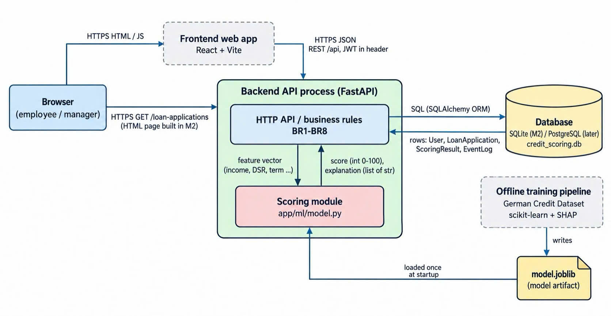
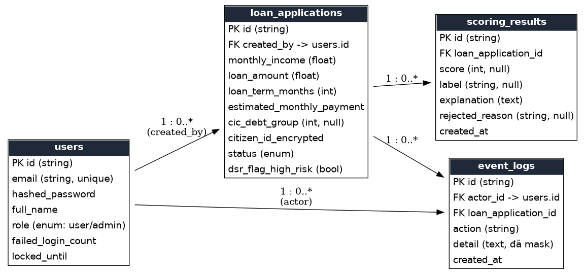

# Design — Credit Scoring Demo

## 1. Architecture



| Component | What it is | Status |
| --- | --- | --- |
| **Browser** | Used by employees and managers (phone or computer). | in use |
| **Frontend web app** | React + Vite single-page app for the screens in M1 section 6. | built (Sprint 3): login, dashboard, new application, application details, list, protected-identifier lookup, employee accounts |
| **Backend API** | FastAPI service. Owns all business logic and enforces BR1-BR8, including identifier encryption/audited lookup and employee account management. | built: auth, applications, scoring, dashboard, manager approval (cancel/edit still to do) |
| **Database** | SQLite file `credit_scoring.db` in development, PostgreSQL for a real deployment (switched by `DATABASE_URL`). | built |
| **Scoring module** | Runs **inside the API process**, not as a separate service. Loads `model.joblib` once at startup. In: feature vector. Out: integer score 0-100 and a list of explanation strings. | built as a rule-based stand-in `rules-v0` (Sprint 3); trained model in Sprint 4 |
| **Offline training pipeline** | Trains on the German Credit Dataset and writes `model.joblib`. The dataset is never loaded into the database; only runtime data is stored. | planned (Sprint 4) |

Every arrow is labelled with what travels along it. The API reaches the database through a library (SQLAlchemy), not through another API.

## 2. Data model



Diagram source: `images/erd.dot`. Money columns are whole VND (`BIGINT`), see Decision 3. Enums are stored by value in `VARCHAR`.
Multiplicity: `1 : 0..*` for a required foreign key, `0..1 : 0..*` for a nullable one.

**`users`** - login accounts with two roles.

| Column | Type | Key | Constraint / which rule |
| --- | --- | --- | --- |
| `id` | VARCHAR (UUID) | PK | |
| `email` | VARCHAR NOT NULL | | UNIQUE |
| `hashed_password` | VARCHAR NOT NULL | | |
| `full_name` | VARCHAR NOT NULL | | |
| `role` | VARCHAR(20) NOT NULL | | enum: `user` or `admin` (supports **BR8**) |
| `failed_login_count` | INTEGER NOT NULL | | default 0 - **US01** (lock after 3 failures) |
| `locked_until` | TIMESTAMPTZ NULL | | **US01** (locked for 15 minutes) |
| `created_at` | TIMESTAMPTZ NOT NULL | | |

**`loan_applications`** - one loan application and its processing state.

| Column | Type | Key | Constraint / which rule |
| --- | --- | --- | --- |
| `id` | VARCHAR (UUID) | PK | |
| `created_by` | VARCHAR NOT NULL | FK -> `users.id` | ON DELETE RESTRICT; required owner |
| `monthly_income` | BIGINT NOT NULL | | CHECK `> 0` - **BR2** |
| `loan_amount` | BIGINT NOT NULL | | CHECK `> 0` |
| `loan_term_months` | INTEGER NOT NULL | | CHECK `> 0` |
| `estimated_monthly_payment` | BIGINT NOT NULL | | required DSR input |
| `credit_history_note` | TEXT NULL | | |
| `purpose` | VARCHAR NULL | | |
| `cic_debt_group` | INTEGER NULL | | CHECK 1 to 5 |
| `citizen_id_encrypted` | VARCHAR NULL | | ciphertext only - **BR7** |
| `citizen_id_last4` | VARCHAR(4) NULL | | last 4 digits only - **BR7** |
| `status` | VARCHAR(20) NOT NULL | | enum: `pending`, `scored`, `manual_review`, `rejected`, `cancelled`, `approved` |
| `dsr_flag_high_risk` | BOOLEAN NOT NULL | | true when DSR > 50% - **BR3** |
| `created_at` | TIMESTAMPTZ NOT NULL | | indexed |
| `updated_at` | TIMESTAMPTZ NOT NULL | | |

**`scoring_results`** - one row per scoring attempt, so an application keeps a history (**US06**).

| Column | Type | Key | Constraint / which rule |
| --- | --- | --- | --- |
| `id` | VARCHAR (UUID) | PK | |
| `loan_application_id` | VARCHAR NOT NULL | FK -> `loan_applications.id` | ON DELETE RESTRICT; indexed with `created_at` |
| `score` | INTEGER NULL | | CHECK 0 to 100 - **BR1**; NULL allowed for a blocked result |
| `label` | VARCHAR(20) NULL | | enum: `rejected` (< 40), `review` (40-69), `eligible` (>= 70) - **BR6** |
| `explanation` | JSON NULL | | list of key factors |
| `rejected_reason` | VARCHAR NULL | | reason code for a blocked or rejected result |
| `model_version` | VARCHAR NULL | | traceability of the model that produced the score |
| `input_snapshot` | JSON NULL | | the inputs used, so a score can be reproduced |
| `created_at` | TIMESTAMPTZ NOT NULL | | |

Business rules enforced by the service/API, rather than by a single column constraint: **BR1** changes an out-of-range model result to `manual_review`; **BR4** rejects CIC groups 3-5; **BR5** limits an application to three scorings per hour and then sets `manual_review`; **BR8** restricts User access to self-created applications while Admin can view all applications. An Admin approval is a separate API authorization decision, not an additional BR8 database constraint.

**`event_logs`** - audit trail of important actions ("who changed what, and when").

| Column | Type | Key | Constraint / which rule |
| --- | --- | --- | --- |
| `id` | VARCHAR (UUID) | PK | |
| `actor_id` | VARCHAR NULL | FK -> `users.id` | ON DELETE SET NULL (the log outlives the user) |
| `loan_application_id` | VARCHAR NULL | FK -> `loan_applications.id` | ON DELETE SET NULL |
| `action` | VARCHAR NOT NULL | | e.g. `loan.created`, `loan.approved`, `citizen_id.viewed`; **BR7** requires every ID view to be logged |
| `detail` | TEXT NULL | | masked text, never a full citizen ID - **BR7** |
| `created_at` | TIMESTAMPTZ NOT NULL | | |

## 3. API design

Conventions: JSON under the `/api` prefix, `Authorization: Bearer <JWT>` on everything except login, money in whole VND,
errors as `{"detail": "<message>"}`. This is the design for the whole product. Built so far: the M2 page in section 4, and in Sprint 3 login, create/list/get application, score, score history and the dashboard summary.
The order of checks when an application is submitted and scored is: BR2 (income > 0) -> save -> BR3 (set the high-risk flag) -> BR5 (3 results per hour, including CIC rejections) -> BR4 (bad-debt group: reject, model not called) -> model -> BR1 (score range) -> BR6 (label).

| Method | Path | Input | Success | Error codes | Covers |
| --- | --- | --- | --- | --- | --- |
| POST | `/api/auth/login` | email, password | 200 + JWT | 401 wrong credentials; 422 invalid body; **423** account locked (US01, 15 min) | US01 (P0) |
| GET | `/api/auth/me` | - | 200 + current user (id, email, full_name, role) | 401 | US01 (added in Sprint 3) |
| POST | `/api/loan-applications` | monthly_income, loan_amount, loan_term_months, estimated_monthly_payment, credit_history_note, purpose, cic_debt_group? , citizen_id?, bank_account? (BR7) | 201 + application (`pending`, high-risk flag set if DSR > 50%) | 401; **422** `{"detail": "<message>", "errors": {"<field>": "<message>"}}` for a missing or malformed field ("Income is required") or income <= 0 | US03, US09 (P0); BR2, BR3 |
| GET | `/api/loan-applications` | - | 200 + list (User: own only; Admin: all) | 401 | US05 list (P1); BR8 |
| GET | `/api/loan-applications/{id}` | - | 200 + data, score, explanation | 401; **403** not the owner; **404** "Application not found" | US05; BR8 |
| PATCH | `/api/loan-applications/{id}` | fields to change | 200 + application | 401; 403; 404; **409** "Application already processed, cannot be edited"; 422 | US10 (P1) |
| PATCH | `/api/loan-applications/{id}/cancel` | - | 200 + cancelled application | 401; 403; 404; 409 already processed | US10 (P1) |
| POST | `/api/loan-applications/{id}/score` | - | 201 + score, label, explanation | 401; 403; 404; 409 cancelled or approved; **429** BR5 limit reached (application becomes `manual_review`) | US04 (P0); BR1, BR3-BR6 |
| GET | `/api/loan-applications/{id}/scores` | - | 200 + history (empty list shown as "No history available") | 401; 403; 404 | US06 (P1) |
| PATCH | `/api/loan-applications/{id}/approve` | - | 200 + application with `status: approved`; writes `loan.approved` audit event | 401; **403** not Admin; 404; **409** cancelled, rejected, already approved, or no latest `eligible` score | Manager approval; US10, BR6 |
| POST | `/api/loan-applications/{id}/sensitive-data/reveal` | no body; explicit lookup | 200 + citizen_id, bank_account (null if absent); audit committed first; no-store headers | 401; 403 not owner/Admin; 404; 503 key or audit unavailable | BR7, BR8 |
| GET | `/api/admin/users` | - | 200 + accounts (no passwords/hashes) | 401; 403 not Admin | BR8 |
| POST | `/api/admin/users` | email, full_name, password (12–128 chars) | 201 + Officer account | 401; 403; 422 invalid/unsupported input; 409 duplicate email | BR8 |
| PATCH | `/api/admin/users/{id}` | full_name?, is_active? | 200 + Officer; audit, session revocation on status change | 401; 403 not Admin or Manager target; 404; 422 | BR8 |
| GET | `/api/dashboard/summary` | - | 200 + today's `total_applications`, `average_score` (null when none), `high_risk_count` and `date` | 401 | US08 (P0) |


### Manager approval contract

The details interface separates a scoring recommendation from a Manager decision.
Only Admin can confirm approval of a scored/manual_review application with a
latest integer score of 70-100 labelled eligible and CIC outside groups 3-5.
The transaction records `status=approved` and one `loan.approved` event together.
The details response includes `approval: null` before approval, or
`approval.actor_id`, `approval.actor_name` and `approval.approved_at` afterwards.
The High risk flag remains visible after the decision; approved applications
cannot be rescored. The confirmation flow and API error text are documented in
[ui.md](ui.md#4-what-changed-since-m2). Approval is not disbursement; US10 edit/cancel
remains pending.

## 4. Walking skeleton

**4.1. Route:** `GET /loan-applications` - returns an HTML page, opened directly in the browser, no login yet.
**Table it reads:** `loan_applications`, created and seeded with **12 rows** by `python -m app.seed` (M2 asks for at least 10).
Settings live in `backend/.env.example` (only `DATABASE_URL`); the real `.env` is never committed. Install steps: `SETUP.md`.


**4.2. How to know it worked:**

Open **http://localhost:8000/loan-applications** in a browser.

Expected: a page titled **"Loan applications (12)"** with a table of exactly 12 rows (owner, income, loan amount, term,
estimated payment, purpose, status, high-risk flag). Three rows show **Yes** in the last column (DSR above 50%, rule BR3).

The data is read from the `loan_applications` table in `credit_scoring.db`, not from a list in the code.
Also available: http://localhost:8000/health returns `{"status":"ok"}`, and http://localhost:8000/docs shows the Swagger UI.

**4.3. Troubleshooting:** 
| Problem | Cause | Fix |
| --- | --- | --- |
| `ModuleNotFoundError: No module named 'fastapi'` (or `pytest` / `dotenv`) | The virtual environment is not active, or step 3 was skipped | Activate it again (`source .venv/bin/activate` or `.venv\Scripts\Activate.ps1`), then run `pip install -r requirements.txt` |
| `ModuleNotFoundError: No module named 'app'` | The command was run outside the `backend/` folder | `cd` into `backend/` and run it again |
| The page says "Loan applications (0)" / "No loan applications yet." | Step 5 (seeding) was skipped, or it ran in another folder so another `credit_scoring.db` was created | Run `python -m app.seed` from `backend/`, then reload the page |
| PowerShell: "running scripts is disabled on this system" | Execution policy blocks the activate script | Run `Set-ExecutionPolicy -Scope CurrentUser RemoteSigned`, or use `cmd` and `.venv\Scripts\activate.bat` |
| `Address already in use` when starting `uvicorn` | Port 8000 is taken by another process | Run `uvicorn app.main:app --reload --port 8001` and open `http://localhost:8001/loan-applications` |
| You want a clean database | The seed only runs on an empty database | Stop the server, delete `credit_scoring.db`, run `python -m app.seed` again |

**4.4. Tested by:** Nguyễn Hoàng Tuấn @Chidokato5376 (Team 05) on a fresh Windows laptop, 4 Oct — 5 minutes.

**4.5. The query behind the page (SQLAlchemy, and the SQL it runs):**

```python
rows = db.query(LoanApplication).order_by(LoanApplication.created_at.desc()).all()
```

```sql
SELECT * FROM loan_applications ORDER BY created_at DESC;
```

The data comes from the database, not from an array in the code. The test `test_route_reads_the_database_not_a_hardcoded_list`
proves it: it inserts one row, calls the page again, and exactly one more row appears.
Known limits: no authentication yet, so BR8 filtering is not applied; the page escapes all text it reads from the database.
The JSON API lives under `/api`, so the final React page can use the M1 screen route `/loan-applications` without a clash.


## 5. Design decisions (ADR)

### Decision 1 - SQLite instead of PostgreSQL for the walking skeleton

**Options:** SQLite file - PostgreSQL in Docker - MySQL.

**Chose:** SQLite.

**Why:** the instructor must run the project in minutes on a machine that has never seen it. PostgreSQL adds Docker or a database service to SETUP.md, and every extra step is a chance to fail for reasons unrelated to our code. SQLite is one file created by `python -m app.seed`, and the tests run on an in-memory SQLite database. All access goes through SQLAlchemy, with only generic column types, so switching is a change of `DATABASE_URL` in `.env`.

**What would change our mind:** the BR5 limit (3 scorings per hour) needs a count-then-insert that stays correct under concurrent requests. If two simultaneous `POST /score` calls for the same application can both pass the check in testing, SQLite's file-level write lock is not enough and we move to PostgreSQL in Sprint 4. We would also move for a real deployment with several users writing at once.


### Decision 2 - Scoring model inside the API process, not a separate service

**Options:** 
-  The API loads a saved model file once at startup and calls it as a function 
-  A separate scoring service that the API calls over HTTP 
-  A managed cloud prediction endpoint.

**Chose:**  The model runs inside the API process

**Why:** this is a demo with one deployable and low traffic. A separate service adds a network call, a second thing to start and a new way to fail, and none of that helps M2 or the first scoring sprint. Loading the model once at startup, and never retraining per request, keeps the output consistent for the same input

**What would change our mind:** 
- We need two model versions running side by side, 
- The model's libraries conflict with the API's libraries
- Loading the model makes startup too slow to be practical. Then we move it behind a separate service, keeping the same function interface so the API code does not change.

### Decision 3 - Money stored as whole VND in BIGINT

**Options:** BIGINT (whole VND) - NUMERIC(15,2) - FLOAT.

**Chose:** BIGINT.

**Why:** VND has no minor unit in practice, so whole numbers lose nothing. Integers are exact, and BR3 is compared in integer arithmetic (`payment * 100 > 50 * income`), so a DSR of exactly 50% is correctly not flagged, which a float could get wrong. 

**What would change our mind:** if the product must support a currency with decimals, or interest calculations that produce fractions of a dong, we switch to NUMERIC with a fixed scale.


## 6. What changed since M1

Writing the design exposed two places where M1 was unclear. Both are resolved in this design.

1. **US03 gains an input: the estimated monthly payment.** BR3 defines DSR as estimated installment divided by monthly income, but US03 lists only
   income, loan amount, loan term, credit history and purpose, so it does not say where the installment comes from. The form and
   `POST /api/loan-applications` now take `estimated_monthly_payment`, and the high-risk flag is set when the application is created. Whether the
   officer types it or it is computed from an interest rate is still to be decided with the Product Owner.
2. **BR1 and BR5 now end in one status.** M1 words them two ways ("Requires manual review" for BR1, "Requires Manager review" for BR5). In the design
   they are one status, `manual_review`, and the cause is kept in `scoring_results.rejected_reason`. The high-risk result of BR3 is separate: it
   sets the `dsr_flag_high_risk` flag and leaves the status as `pending`.
3. **Approval is now an explicit Manager action.** `approved` was already a valid status in US10, but there was no API to reach it. An Admin can now
   call `PATCH /api/loan-applications/{id}/approve` only after the latest score is `eligible`; the transition is recorded as `loan.approved` in the audit log.


## 7. What changed since M2

M2 delivered one real route (`GET /loan-applications`, HTML, no login) and a design for the rest. Sprint 3 turned the API design into working code, put a React interface on it, and added a first scoring model. Full per-change history with PR numbers: [`docs/changelog.md`](changelog.md).

1. **The API went from one route to twelve JSON endpoints.** Section 3.1 is now a list of what exists, not of what is planned. Login with lockout, loan creation, list and detail, scoring, score history, dashboard summary, manager approval and employee management are built. Edit and cancel (US10) are not built.

2. **Every route now needs a token.** M2 said "no authentication yet, so BR8 filtering is not applied". Now the HTML skeleton page is protected as well, and BR8 is enforced on every read: an Officer gets `403` for another Officer's application and sees only their own in lists and in the dashboard. Tokens are HS256 JWTs (8 h by default) that carry a per-user `token_version`.

3. **Two columns were added to `users`:** `is_active BOOLEAN NOT NULL DEFAULT TRUE` and `token_version INTEGER NOT NULL DEFAULT 0`. A Manager deactivates an Officer with `PATCH /api/admin/users/{id}`; this increments `token_version`, so tokens issued before the change stop working, including after reactivation. `app/migrate.py` adds the two columns to an existing M2 database without deleting rows. The ERD image and the `users` table in section 2 have not been updated yet.

4. **Business rules BR1, BR4, BR5 and BR6 are enforced in code** (section 3.3). BR8 gained its second half: account management by the Manager.

5. **Approval is built as designed in section 6**, with one addition: the status change is a single conditional `UPDATE` that also checks the latest score has not changed, so two Managers, or a rescoring in parallel, cannot approve a stale result (`409`).

6. **Response shapes grew.** The dashboard summary now also returns `date` and `high_risk_count`. List and detail responses include `owner_name`, `dsr_percent` and `latest_score`; the detail adds `approval`. Results carry `label_text`, `rejected_reason` and `model_version`.

7. **The frontend is built** (React + Vite on port 5173, `/api` proxied to port 8000), so the "Frontend web app" row in section 1 is no longer "planned (Sprint 3)".