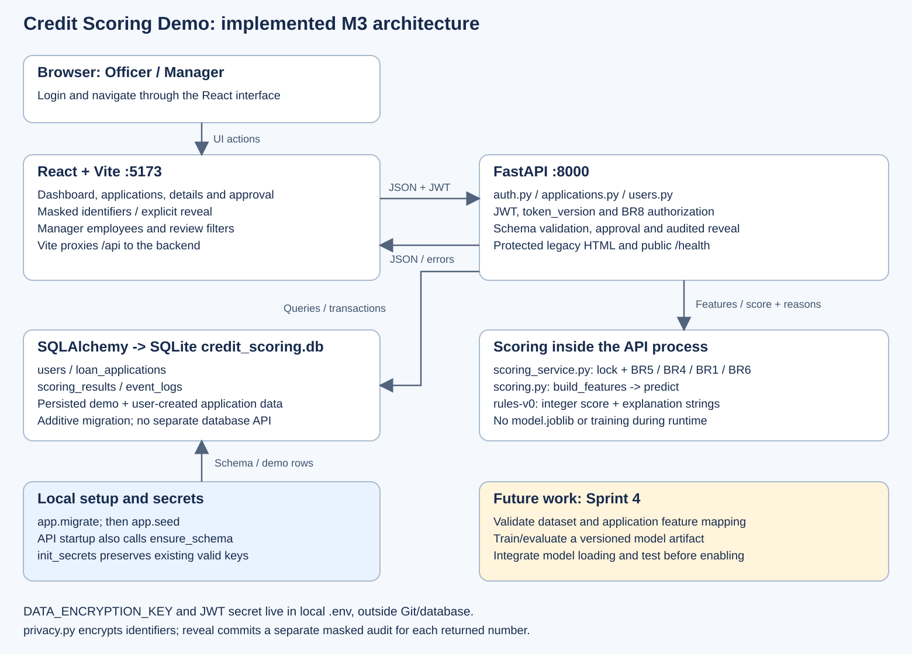
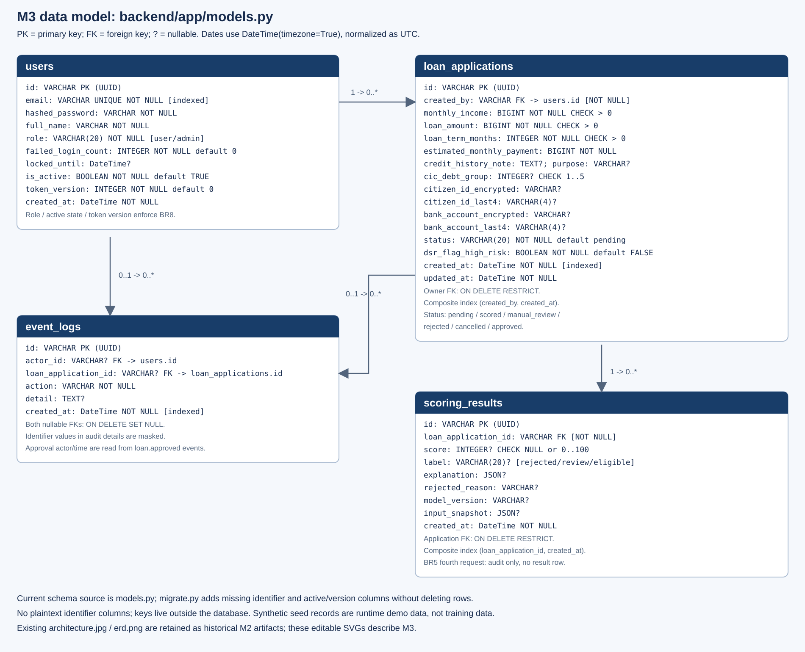

# Design — Credit Scoring Demo

## 1. Architecture



The editable diagram source is [architecture-m3.svg](images/architecture-m3.svg). It shows the implementation in this sprint; the earlier `architecture.jpg` is retained as an M2 artifact.

| Component | What it is | Status |
| --- | --- | --- |
| **Browser** | Used by employees and managers (phone or computer). | in use |
| **Frontend web app** | React + Vite single-page app for the screens in M1 section 6. | built (Sprint 3): login, dashboard, new application, application details, list, protected-identifier lookup, employee accounts |
| **Backend API** | FastAPI service. Owns all business logic and enforces BR1-BR9, including identifier encryption/audited lookup and employee account management. | built: auth, applications, scoring, dashboard, manager approval (cancel/edit still to do) |
| **Database** | SQLite file `credit_scoring.db`, accessed through SQLAlchemy. PostgreSQL is a future deployment option that also needs a driver, configuration and integration/concurrency testing. | SQLite built/tested; PostgreSQL planned |
| **Scoring module** | `app/scoring_service.py` applies rule guards and calls `build_features` / `predict` in `app/scoring.py` inside the API process. `rules-v0` returns an integer score and explanation strings; no model artifact is loaded. | deterministic rules built in Sprint 3; trained model planned for Sprint 4 |
| **Offline training pipeline** | Planned evaluation of German Credit and a versioned preprocessing/model artifact, subject to feature mapping and licensing checks. No training pipeline or `model.joblib` loading exists in M3. Training records are separate from runtime application records. | planned (Sprint 4) |

Every arrow is labelled with what travels along it. The API reaches the database through a library (SQLAlchemy), not through another API.

## 2. Data model



The editable diagram source is [erd-m3.svg](images/erd-m3.svg), corresponding to [models.py](../backend/app/models.py). The earlier `erd.png` is retained as an M2 artifact. Money columns are whole VND (`BIGINT`), see Decision 3. Enums are stored by value in `VARCHAR`.
Multiplicity: `1 : 0..*` for a required foreign key, `0..1 : 0..*` for a nullable one. Date/time columns use SQLAlchemy `DateTime(timezone=True)`; code normalizes values read from SQLite as UTC because SQLite does not preserve a timezone offset.

**`users`** - login accounts with two roles.

| Column | Type | Key | Constraint / which rule |
| --- | --- | --- | --- |
| `id` | VARCHAR (UUID) | PK | |
| `email` | VARCHAR NOT NULL | | UNIQUE |
| `hashed_password` | VARCHAR NOT NULL | | |
| `full_name` | VARCHAR NOT NULL | | |
| `role` | VARCHAR(20) NOT NULL | | enum: `user` or `admin` (supports **BR8**) |
| `failed_login_count` | INTEGER NOT NULL | | default 0 - **US01** (lock after 3 failures) |
| `locked_until` | DateTime(timezone=True) NULL | | **US01** (locked for 15 minutes) |
| `is_active` | BOOLEAN NOT NULL | | default TRUE; inactive accounts cannot log in or use tokens - **BR8** |
| `token_version` | INTEGER NOT NULL | | default 0; changing active status invalidates earlier tokens - **BR8** |
| `created_at` | DateTime(timezone=True) NOT NULL | | |

**`loan_applications`** - one loan application and its processing state.

| Column | Type | Key | Constraint / which rule |
| --- | --- | --- | --- |
| `id` | VARCHAR (UUID) | PK | |
| `created_by` | VARCHAR NOT NULL | FK -> `users.id` | ON DELETE RESTRICT; required owner |
| `monthly_income` | BIGINT NOT NULL | | CHECK `> 0` - **BR2** |
| `loan_amount` | BIGINT NOT NULL | | CHECK `> 0` |
| `loan_term_months` | INTEGER NOT NULL | | CHECK `> 0` |
| `estimated_monthly_payment` | BIGINT NOT NULL | | required DSR input |
| `credit_history_note` | TEXT NULL | | |
| `purpose` | VARCHAR NULL | | |
| `cic_debt_group` | INTEGER NULL | | CHECK 1 to 5 |
| `citizen_id_encrypted` | VARCHAR NULL | | ciphertext only - **BR7** |
| `citizen_id_last4` | VARCHAR(4) NULL | | last 4 digits only - **BR7** |
| `bank_account_encrypted` | VARCHAR NULL | | ciphertext only - **BR7** |
| `bank_account_last4` | VARCHAR(4) NULL | | last 4 digits only - **BR7** |
| `status` | VARCHAR(20) NOT NULL | | enum: `pending`, `scored`, `manual_review`, `rejected`, `cancelled`, `approved` |
| `dsr_flag_high_risk` | BOOLEAN NOT NULL | | true when DSR > 50% - **BR3** |
| `created_at` | DateTime(timezone=True) NOT NULL | | indexed |
| `updated_at` | DateTime(timezone=True) NOT NULL | | |

**`scoring_results`** - one row per persisted scoring result, including BR4 rejection and BR1 invalid-output results. The BR5-blocked fourth request creates an audit event and changes status without adding a result. The history API is built; the dedicated **US06** history screen remains pending.

| Column | Type | Key | Constraint / which rule |
| --- | --- | --- | --- |
| `id` | VARCHAR (UUID) | PK | |
| `loan_application_id` | VARCHAR NOT NULL | FK -> `loan_applications.id` | ON DELETE RESTRICT; indexed with `created_at` |
| `score` | INTEGER NULL | | CHECK 0 to 100 - **BR1**; NULL for BR1 invalid-output or BR4 CIC rejection |
| `label` | VARCHAR(20) NULL | | enum: `rejected` (< 40), `review` (40-69), `eligible` (>= 70) - **BR6** |
| `explanation` | JSON NULL | | list of key factors |
| `rejected_reason` | VARCHAR NULL | | `score_out_of_range`, `cic_bad_debt_group` or `score_below_40`; BR5 is recorded in `event_logs` |
| `model_version` | VARCHAR NULL | | traceability of the model that produced the score |
| `input_snapshot` | JSON NULL | | the inputs used, so a score can be reproduced |
| `created_at` | DateTime(timezone=True) NOT NULL | | |

Business rules enforced by the service/API, rather than by a single column constraint: **BR1** changes an out-of-range model result to `manual_review`; **BR4** rejects CIC groups 3-5; **BR5** counts persisted results in the previous hour (including CIC rejections); a fourth request sets `manual_review`, writes `loan.score_blocked` and returns 429 without inserting a `scoring_results` row; **BR8** restricts User access to self-created applications while Admin can view all applications. An Admin approval is a separate API authorization decision, not an additional BR8 database constraint.

**`event_logs`** - audit trail of important actions ("who changed what, and when").

| Column | Type | Key | Constraint / which rule |
| --- | --- | --- | --- |
| `id` | VARCHAR (UUID) | PK | |
| `actor_id` | VARCHAR NULL | FK -> `users.id` | ON DELETE SET NULL (the log outlives the user) |
| `loan_application_id` | VARCHAR NULL | FK -> `loan_applications.id` | ON DELETE SET NULL |
| `action` | VARCHAR NOT NULL | | e.g. `loan.created`, `loan.approved`, `loan.score_blocked`, `citizen_id.viewed`, `bank_account.viewed`; **BR7** logs each returned identifier |
| `detail` | TEXT NULL | | action-specific audit text; identifiers appear only as masked suffixes, never full numbers - **BR7** |
| `created_at` | DateTime(timezone=True) NOT NULL | | |

## 3. API design

Conventions: JSON under `/api`, money in whole VND, and `Authorization: Bearer <JWT>` on all business operations except login. `/health` and the API documentation are public utility routes, outside this table. Errors carry a string `detail`; request-schema validation adds an `errors` object keyed by field. Role names in code are `user` (Officer) and `admin` (Manager).

There are **13 implemented API operations** in the first table. The two US10 edit/cancel operations are a product design only, listed separately; they are not registered routes. Ordinary application responses include masked identifiers and a latest-result summary; only the explicit authorized reveal response returns full numbers.

The create flow validates BR2/BR9/input, computes BR3 and saves a pending application. Scoring is a separate request: it acquires a database write lock, rejects cancelled/approved states, builds features, checks BR5 before BR4, then calls `rules-v0`, validates BR1 and assigns the BR6 label. A high-risk flag is independent of the numeric score. See [scoring_service.py](../backend/app/scoring_service.py) and [transactions.py](../backend/app/transactions.py).

| Method | Path | Input | Success | Error codes | Covers |
| --- | --- | --- | --- | --- | --- |
| POST | `/api/auth/login` | email, password | 200 + access_token, token_type and user | 401 wrong credentials; 403 inactive; 422 invalid body; 423 account locked for 15 min | US01 (P0) |
| GET | `/api/auth/me` | - | 200 + id, email, full_name, role, is_active | 401 | US01 |
| POST | `/api/loan-applications` | monthly_income, loan_amount, loan_term_months, estimated_monthly_payment; optional credit_history_note, purpose, cic_debt_group, citizen_id, bank_account | 201 + application (`pending`, high-risk flag when DSR > 50%) | 401; 422 field errors/extra fields; 503 identifier key unavailable | US03, US09 (P0); BR2, BR3, BR7, BR9 |
| GET | `/api/loan-applications` | - | 200 + list (Officer: own; Admin: all), newest first | 401 | US05; BR8 |
| GET | `/api/loan-applications/{id}` | - | 200 + application, latest_score, approval metadata | 401; 403 not owner/Admin; 404 missing application | US05; BR8 |
| POST | `/api/loan-applications/{id}/score` | - | 201 + `result` and `application`; BR1/BR4 outcomes are persisted results | 401; 403; 404; 409 cancelled/approved; 429 BR5 limit, changes status to `manual_review` | US04 (P0); BR1, BR3-BR6 |
| GET | `/api/loan-applications/{id}/scores` | - | 200 + results ordered by created_at/id ascending; empty list when none | 401; 403; 404 | US06 API only; history UI pending |
| PATCH | `/api/loan-applications/{id}/approve` | no body | 200 + application, status `approved`, approval metadata; atomic `loan.approved` audit | 401; 403 not Admin; 404; 409 invalid/stale state or result | Manager approval; US10, BR6 |
| POST | `/api/loan-applications/{id}/sensitive-data/reveal` | no body; explicit lookup | 200 + citizen_id and bank_account, null if absent; access audit committed before returning each present value; Cache-Control no-store, Pragma no-cache | 401; 403 not owner/Admin; 404 missing application; 503 key/audit unavailable | BR7, BR8 |
| GET | `/api/admin/users` | - | 200 + accounts without passwords/hashes | 401; 403 not Admin | BR8 |
| POST | `/api/admin/users` | email, full_name, password (12-128 chars) | 201 + Officer account | 401; 403; 422 invalid/unsupported input; 409 duplicate email | BR8 |
| PATCH | `/api/admin/users/{id}` | full_name?, is_active? | 200 + Officer; audit and token-version increment when active status changes | 401; 403 not Admin or Manager target; 404; 422 | BR8 |
| GET | `/api/dashboard/summary` | - | 200 + date, total_applications, average_score (null when none), high_risk_count | 401 | US08 (P0); BR8 |

The dashboard selects applications **created during today's Vietnam calendar day (UTC+7)**, using UTC start/end boundaries. It averages the latest result of each selected application only when that result has a numeric score; it does not fall back to an earlier result. It does not average all scoring attempts or select attempts by the scoring date. Officer scope is their own applications; Manager scope is the whole branch. Seed loans have earlier creation dates, so a fresh seed can correctly show zero applications today.

For 422 schema errors the common `detail` is `Please correct the highlighted fields and submit again.` The exact field messages are listed in [ui.md section 3](ui.md#3-error-messages). S4-05 makes missing, empty, whitespace-only and null `monthly_income` return exactly `Income is required`; nonnumeric or malformed numeric input returns `Monthly income must be a whole number.` The API wording gap is fixed; independent browser acceptance still needs a recorded result. BR9 errors identify `estimated_monthly_payment` and invalid requests save no new application.

**Planned operations (not implemented in M3):**

| Method | Path | Planned input/result | Covers |
| --- | --- | --- | --- |
| PATCH | `/api/loan-applications/{id}` | Update editable fields of an unprocessed application; planned 401/403/404/409/422 checks | US10 edit |
| PATCH | `/api/loan-applications/{id}/cancel` | Cancel an unprocessed application; planned 401/403/404/409 checks | US10 cancel |


### Manager approval contract

The details interface separates a scoring recommendation from a Manager decision.
Only Admin can confirm approval of a scored/manual_review application with a
latest integer score of 70-100 labelled eligible and CIC outside groups 3-5.
The transaction records `status=approved` and one `loan.approved` event together.
The details response includes `approval: null` before approval, or
`approval.actor_id`, `approval.actor_name` and `approval.approved_at` afterwards.
The High risk flag remains visible after the decision; approved applications
cannot be rescored. The confirmation flow and API error text are documented in
[ui.md](ui.md#4-what-changed-since-m2). Approval is not disbursement; US10 edit/cancel
remains pending.


### Application input validation and BR9 (S4-05)

`POST /api/loan-applications` accepts whole-number monetary inputs and a whole-number
term/CIC group, rejecting booleans and malformed numeric text such as `1_000`, `1.5`
and `+5`. Surrounding whitespace is trimmed. Missing, blank or null required income
returns exactly `Income is required`; optional blank CIC becomes NULL. Optional purpose
and credit-history text are trimmed before the 500-character limit and blank text becomes NULL.

BR9 requires payment <= loan amount and payment x term >= loan amount. Invalid requests
return 422 with `errors.estimated_monthly_payment` set respectively to
`Estimated monthly payment must not exceed the loan amount.` or
`Estimated monthly payment multiplied by the loan term must cover the loan amount.`
When loan/term is already invalid, skip the dependent BR9 check and report that field.
All validation failures save no new loan. Unknown fields and non-object/malformed bodies
receive clear field/form errors through the shared validation handler.

## 4. Walking skeleton retained from M2

### 4.1 Current route and normal entry point

`GET /loan-applications` still returns the database-backed HTML table from M2, but now requires the same Bearer token as the JSON API and applies BR8 ownership filtering. Opening `http://localhost:8000/loan-applications` without a token returns **401**; the backend root redirects there and is not the normal interactive entry point.

Use the React application at **http://localhost:5173**, sign in and navigate through the menus as described in [SETUP.md](SETUP.md). Its `/loan-applications` route uses `GET /api/loan-applications`; Vite proxies `/api` to port 8000. The legacy HTML route remains for automated compatibility/database checks, not for unauthenticated browser access.

### 4.2 Data and expected scope

The demo seed inserts three accounts and twelve synthetic applications into the database when there are no applications. On that untouched seed, Thanh (Admin) can read twelve rows, Hoang seven and Linh five. These are seed expectations, not fixed UI counts: creating a new application changes the appropriate list. Three seed loans have DSR above 50%. Normal demo data is persisted in `credit_scoring.db`; it is not a hardcoded response list.

From `backend/`, follow `python -m app.init_secrets`, `python -m app.migrate`, then `python -m app.seed` as documented in SETUP. Migration is additive and preserves existing rows. Seed creates missing tables but **does not add columns to existing tables**; always migrate an older database before seeding. It skips insertion when any loan applications already exist. Preserve an existing database and encryption key when upgrading.

`http://localhost:8000/health` returns `{"status":"ok"}`; `http://localhost:8000/docs` exposes the API documentation. Settings are illustrated in `backend/.env.example`; the local `.env` and secrets are not committed.

### 4.3 Troubleshooting

| Problem | Cause | Fix |
| --- | --- | --- |
| Missing `fastapi`, `pytest` or `dotenv` | Wrong interpreter or dependencies not installed | Use the backend virtual-environment interpreter and install `requirements.txt` as in SETUP |
| `No module named app` | Command run outside `backend/` | Run the module command from `backend/` |
| 401 on port 8000 `/loan-applications` | Legacy route requires a Bearer token | Use the frontend on port 5173 and sign in; API checks must supply the token |
| Empty list after login | No applications in the selected user's scope | Check the demo account and database path; seed only an unpopulated demo database |
| `no such column` after upgrading | Existing tables were not migrated | Back up the database/key, run `python -m app.migrate` before seed, then restart |
| PowerShell activation script blocked | Execution policy blocks activation | Invoke `.venv\Scripts\python.exe` directly as shown in SETUP |
| Port 8000 already in use | Another process owns the configured backend port | Stop the old development server, or change both the backend port and frontend proxy configuration |

### 4.4 Historical check and current automated coverage

The M2 record reports a fresh Windows check by Nguyễn Hoàng Tuấn (@Chidokato5376, Team 05) on 4 October. That historical check covered the original public HTML page; it does not establish M3 browser acceptance. Current automated checks in [test_walking_skeleton.py](../backend/tests/test_walking_skeleton.py) verify token requirements, seeded per-role counts, owner filtering, HTML escaping and database reads. Running-app evidence and actual browser results are recorded separately in [ui.md](ui.md#4-what-changed-since-m2).

### 4.5 Query used by the retained HTML route

```python
query = db.query(LoanApplication).options(joinedload(LoanApplication.created_by_user))
if user.role != UserRole.ADMIN:
    query = query.filter(LoanApplication.created_by == user.id)
rows = query.order_by(LoanApplication.created_at.desc(), LoanApplication.id).all()
```

The equivalent Officer query includes `WHERE created_by = :user_id`; Admin omits that restriction. Stored text is HTML-escaped. `test_route_reads_the_database_not_a_hardcoded_list` inserts a row and verifies that the authenticated page gains exactly that row.


## 5. Design decisions (ADR)

### Decision 1 - SQLite instead of PostgreSQL for the walking skeleton

**Options:** SQLite file - PostgreSQL in Docker - MySQL.

**Chose:** SQLite.

**Why:** the instructor must run the project in minutes on a machine that has never seen it. PostgreSQL adds Docker or a database service to SETUP.md, and every extra step is a chance to fail for reasons unrelated to our code. SQLite is one file created by `python -m app.seed`, and the tests run on an in-memory SQLite database. All access goes through SQLAlchemy. PostgreSQL remains a planned deployment option: changing `DATABASE_URL` also requires a compatible driver and verification of migrations, timezone behavior and concurrent transactions. It is not covered by the current SQLite test results.

**Concurrency behavior in M3:** `lock_application` executes a no-op update before refreshing the loan and counting results. SQLite holds its writer lock until commit/rollback; this serializes score and approval decisions across sessions. [test_br_integrity.py](../backend/tests/test_br_integrity.py) checks simultaneous scoring against a temporary SQLite file. PostgreSQL would still need its own driver and integration/concurrency tests before deployment.

**What would change our mind:** a real deployment needing higher write concurrency or operational database services would justify evaluating PostgreSQL in Sprint 4.


### Decision 2 - Scoring model inside the API process, not a separate service

**Options:**
-  The API loads a saved model file once at startup and calls it as a function
-  A separate scoring service that the API calls over HTTP
-  A managed cloud prediction endpoint.

**Chose:** The scoring function runs inside the API process. M3 implements this with `app/scoring.py` and `rules-v0`, with no saved-model loading. A trained artifact is planned for Sprint 4 behind the same function interface.

**Why:** this demo has one backend deployable and low traffic. A separate service adds a network call, another process to start and another failure mode. The current deterministic rules give the same output for the same inputs. If a trained artifact is introduced, load its versioned preprocessing/model once at startup rather than retraining per request.

**What would change our mind:**
- We need two model versions running side by side,
- The model's libraries conflict with the API's libraries
- Loading the model makes startup too slow to be practical. Then we move it behind a separate service, keeping the same function interface so the API code does not change.

### Decision 3 - Money stored as whole VND in BIGINT

**Options:** BIGINT (whole VND) - NUMERIC(15,2) - FLOAT.

**Chose:** BIGINT.

**Why:** VND has no minor unit in practice, so whole numbers lose nothing. Integers are exact, and BR3 is compared in integer arithmetic (`payment * 100 > 50 * income`), so a DSR of exactly 50% is correctly not flagged, which a float could get wrong.

**What would change our mind:** if the product must support a currency with decimals, or interest calculations that produce fractions of a dong, we switch to NUMERIC with a fixed scale.


## 6. What changed since M1

The M2 design clarified input and state decisions from M1. Sprint 3 subsequently implemented the explicit Manager decision described below.

1. **US03 gains an input: the estimated monthly payment.** BR3 defines DSR as estimated installment divided by monthly income, but US03 lists only
   income, loan amount, loan term, credit history and purpose, so it does not say where the installment comes from. The form and
   `POST /api/loan-applications` now take `estimated_monthly_payment`, and the high-risk flag is set when the application is created. In the M3 form the officer enters this amount; automatic calculation from an interest rate is not implemented.
2. **BR1 and BR5 now end in one status.** M1 words them two ways ("Requires manual review" for BR1, "Requires Manager review" for BR5). In the design
   they share the status `manual_review`. BR1 persists `score_out_of_range` in `scoring_results.rejected_reason`; a BR5-blocked request writes `loan.score_blocked` to `event_logs` without another result. The high-risk result of BR3 is separate: it
   sets the `dsr_flag_high_risk` flag and leaves the status as `pending`.
3. **Approval is now an explicit Manager action.** `approved` was already a valid status in US10, but there was no API to reach it. An Admin can now
   call `PATCH /api/loan-applications/{id}/approve` only after the latest score is `eligible`; the transition is recorded as `loan.approved` in the audit log.


## 7. What changed since M2

M2 delivered one real route (`GET /loan-applications`, HTML, no login) and a design for the rest. Sprint 3 turned the API design into working code, put a React interface on it, and added deterministic scoring rules. The implementation change history (PR links where recorded) is in: [`docs/changelog.md`](changelog.md).

1. **The API went from one HTML route to thirteen JSON operations.** Section 3 separates implemented operations from the two planned US10 routes. Login with lockout, loan creation, list and detail, scoring, score history, dashboard summary, manager approval and employee management are built. Edit and cancel (US10) are not built.

2. **Business operations other than login now need a token.** M2 said "no authentication yet, so BR8 filtering is not applied". Now the HTML skeleton page is protected as well, and BR8 is enforced on every read: an Officer gets `403` for another Officer's application and sees only their own in lists and in the dashboard. Tokens are HS256 JWTs (8 h by default) that carry a per-user `token_version`.

3. **Two columns were added to `users`:** `is_active BOOLEAN NOT NULL DEFAULT TRUE` and `token_version INTEGER NOT NULL DEFAULT 0`. A Manager deactivates an Officer with `PATCH /api/admin/users/{id}`; this increments `token_version`, so tokens issued before the change stop working, including after reactivation. `app/migrate.py` adds the two columns to an existing M2 database without deleting rows. The current ERD and `users` table in section 2 include both fields.

4. **Business rules BR1, BR4, BR5 and BR6 are enforced in code** (section 3 and `scoring_service.py`). BR8 gained its second half: account management by the Manager.

5. **Approval is built as designed in section 6**, with one addition: the status change is a single conditional `UPDATE` that also checks the latest score has not changed, so two Managers, or a rescoring in parallel, cannot approve a stale result (`409`).

6. **Response shapes grew.** The dashboard summary now also returns `date` and `high_risk_count`. List and detail responses include `owner_name`, `dsr_percent` and `latest_score`; the detail adds `approval`. Results carry `label_text`, `rejected_reason` and `model_version`.

7. **The frontend is built** (React + Vite on port 5173, `/api` proxied to port 8000), so the "Frontend web app" row in section 1 is no longer "planned (Sprint 3)".

## 8. UI-driven design changes in M3

Building the screens changed the design in four places. Details and the reasons are also in `docs/ui.md` section 4.

1. **Field-level validation errors.** A `422` on `POST /api/loan-applications` now carries `errors` (one message per field) next to the string `detail`, so the form can mark the wrong input and list every problem at once (US09).
2. **`GET /api/auth/me` added**, and the dashboard summary returns `date` and `high_risk_count`. "Today" is computed in Vietnam time (UTC+7) from application creation time; the summary uses only the latest score of each application created during that day.
3. **Scoring in Sprint 3 is a rule-based stand-in (`rules-v0`).** The interface from Decision 2 is unchanged. Its best case is 95 points, so a normal run never trips BR1; BR1 stays as a guard for the Sprint 4 model.
4. **BR7 is implemented in Sprint 3.** Optional Citizen ID/account fields are validated and encrypted before storage. Ordinary responses are masked; a dedicated authorized lookup decrypts and commits access logs before returning numbers. See section 11.


Implementation change history is recorded separately in [changelog.md](changelog.md).

## 9. M3 implementation clarifications

- `pending` is the stored status for US03 "Scoring in progress". The UI saves the application, requests scoring, then opens its details. A scoring error preserves the application and offers retry.
- BR5 is checked before BR4, including CIC groups 3-5. Invalid/noninteger model output is hidden under BR1.
- The retained HTML route requires a token and filters owners. The public entry on port 8000 redirects to that protected route; use port 5173 for normal browser navigation.
- BR7 and employee management (BR8) are implemented and tested. US07 notifications, US06 history UI and US10 edit/cancel remain pending. Manager approval is implemented with an audit event and frontend confirmation.

## 10. Manager decision after scoring

Scoring is a recommendation, not approval. An officer creates/scores a loan application and opens its details. Manager Thanh signs in, uses Branch applications -> Review, reviews the data/reasons and (when the latest score is eligible, 70-100) selects Approve application -> Confirm approval. Only Admin can call `PATCH /api/loan-applications/{id}/approve`; no request body is required. The state changes from scored/manual_review to approved and `loan.approved` records actor, time, score and high-risk flag in the same transaction. GET details and PATCH approve return an `approval` object (actor_id, actor_name, approved_at), or null if none exists. No database migration is needed; the existing event_logs table supplies the approval history.

Cancelled/rejected/approved applications, unscored or noneligible latest results and CIC groups 3-5 are refused. High-risk flags are retained; an explicit Manager decision reviews the BR3 warning. BR5 manual_review may be resolved by a Manager only if the latest result is eligible. A stale status/result fails the conditional update with 409. Once approved, scoring remains blocked. Approval does not perform a payment or disbursement; the product tracks application assessment and the Manager decision. US10 edit/cancel remains a separate pending feature, so this addition does not mark all US10 acceptance criteria Done.

## 11. Identifier protection and employee accounts (BR7/BR8)

`privacy.py` uses authenticated Fernet encryption from `cryptography`, with a locally generated `DATA_ENCRYPTION_KEY` supplied through `.env`. The key is outside the database and Git. Citizen ID accepts 9/12 ASCII digits; account number accepts 6–20 ASCII digits, preserving leading zeros. Neither identifier is a scoring feature or part of `input_snapshot`. Raw invalid input and raw invalid model output are never echoed into application audit logs. Normal create/list/detail/score responses contain only `citizen_id_masked`/`bank_account_masked` (or null).

The owner or Admin explicitly calls POST sensitive-data/reveal. BR8 is checked before decryption. Successful reads create `citizen_id.viewed` and/or `bank_account.viewed` events with actor_id, loan_application_id, created_at and only masked last four digits in detail. Audit commit failure or wrong/missing key returns 503 without releasing numbers. Successful responses set `Cache-Control: no-store` and `Pragma: no-cache`. The UI retains full numbers only in component memory, masks after 30 seconds/blur/tab hiding, and discards pending stale reveal responses. It does not save numbers to browser storage.

Manager-only `/admin/users` supports listing accounts, creating Officers (hashed password), updating names and active status. Inactive accounts cannot log in or use existing tokens. Incrementing token_version prevents old tokens working after reactivation. Account events store the target UUID and status, without names, email or passwords. Officer ownership remains enforced on list/detail/history/score/reveal/legacy HTML; Managers see the branch data. Manager accounts cannot be modified through employee management, and client-supplied roles/owners/ciphertext/state are rejected.

`python -m app.migrate` adds missing citizen-ID, bank-account and user active/version columns to existing databases, without deleting rows. New tables use the full current schema. API startup runs the same idempotent `ensure_schema` migration. Seed only creates missing tables and inserts demonstration rows; it does not alter existing tables, so run migration before seeding an older database. `python -m app.init_secrets` initializes local secrets once, preserving a valid existing key. See SETUP.md for upgrade and key-backup instructions.

## 12. Role-specific entry points and Manager backlog

Both roles use `/dashboard`, but the Officer sees their own daily metrics and create/track actions. Manager sees branch-wide daily metrics plus an all-date review queue and employee-management action. The API's BR8 filter supplies the correct scope; there is no client-side substitute for authorization.

The Manager Dashboard combines the existing GET dashboard summary with GET applications. The queue contains `pending`, `scored`, `manual_review`; it excludes approved/rejected/cancelled records even if high-risk. Sort high-risk first, then manual review, then oldest creation date and ID. Show eight rows and a link to the complete queue. No queue state is stored separately, so reopening/reloading the Dashboard reflects approval. Pending rows are visible for follow-up/scoring, but cannot be approved until a valid eligible score exists.

`/loan-applications?view=review|high-risk|eligible` links open the matching Manager filter; `owner` combines an employee filter. All-date counts are labelled separately from today's statistics. Officer sees My applications; Manager sees Branch applications/Created by and filter controls. Details and queue use the same UI eligibility helper, while PATCH approve still independently validates server-side. New application remains available to Admin because BR8 does not prohibit creation. This queue is not the unread-notification feature (US07).

Frontend validation: Node tests exercise queue membership/order, old backlog with zero-today activity, final-state exclusion, eligibility and combined filters. The actual React routes are rendered for both roles to verify different headings, navigation and Manager-only route guidance. Interactive browser acceptance remains required.

## 13. Sprint 4 model plan

Candidate dataset: German Credit. Validate licensing, feature meanings and target mapping before use. Split train/validation/test before preprocessing; compare a logistic-regression baseline with a tree model using ROC-AUC, precision/recall and calibration. Keep synthetic runtime demo records separate from training data. Dataset features must map explicitly to the application's available inputs; unresolved mappings block replacing `rules-v0`. Export a versioned preprocessing/model artifact, preserve `predict(features) -> (integer score, reasons)`, and test BR1/BR4/BR6 before enabling it. Document how probability maps to 0-100 and how explanations are computed.
