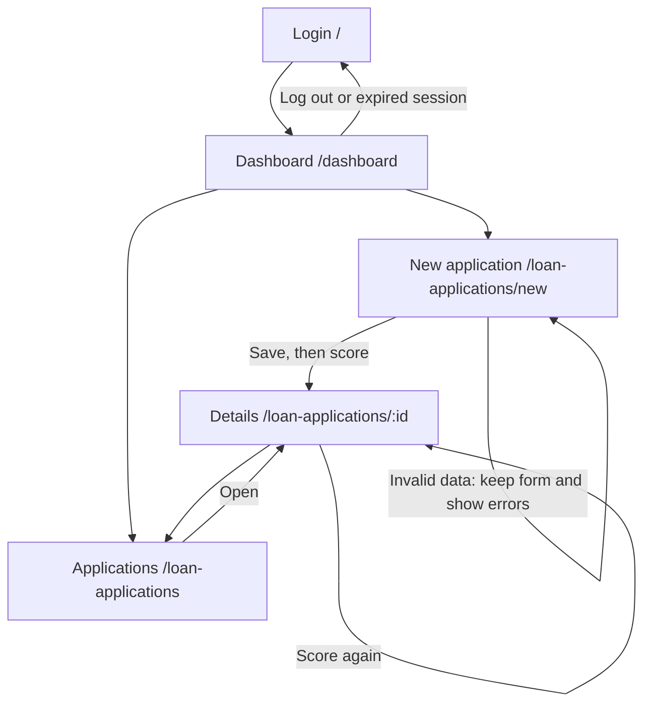

# UI - Credit Scoring Demo (Milestone 3)

How to run the app and which test accounts to use: see [`SETUP.md`](SETUP.md). Screens are React pages (`frontend/src/pages`) that call the FastAPI backend under `/api`.

## 1. P0 stories and status

| Story | Screen(s) | Route | Status | Issue |
| --- | --- | --- | --- | --- |
| US01 Log in with my account | Login | `/` | partly works (implemented; independent browser acceptance pending; log out is a button in the top bar; the 15-minute lock is shown as a message) | #9 |
| US03 Input a loan application | New application | `/loan-applications/new` | partly works (implemented; independent browser acceptance pending; saves, flags High risk when DSR > 50%, scores right away) | #10 |
| US04 View the credit score with explanations | Application details | `/loan-applications/:id` | partly works (implemented; independent browser acceptance pending; score 0-100, label, factors, CIC group; rule-based model `rules-v0`, the trained model comes in Sprint 4) | #11 |
| US08 Overview dashboard | Dashboard | `/dashboard` | partly works (implemented; independent browser acceptance pending; today's total, average score, high-risk count; shows "0 applications today" when empty) | #13 |
| US09 Alert on missing or malformed data | New application | `/loan-applications/new` | partly works (implemented; independent browser acceptance pending; summary box at the top + a message under each wrong field; nothing is saved) | #14 |

Also built, not P0: `/loan-applications` (list, P1, US05 partly) so a person can reach any application without typing a URL.

**Screen flow:** the list is reachable from the top bar/dashboard; Submit and score opens details. The diagram below covers the P0 paths in this branch.



### #157 verification record - 16 October 2026 (Vietnam)

Base implementation: commit `0b88dc3` on `119-score-feedback`; integration fixes are in the `157-p0-verification` branch. Test data uses a separate local SQLite database under the ignored `.venv/` directory. No production database or source-repository data is used.

**Browser acceptance: pending.** The computer-use session reported no connected browsers. Attempts to open Chrome and the in-app browser both returned `Browser is not available`. No five-story browser walkthrough or screenshots were produced. All five stories remain **partly works**; the checks below are not browser evidence.

Integration defects reproduced before fixing:

- **Missing New application route:** the existing top-bar/dashboard links matched `/loan-applications/:id` with `id=new`, rather than the existing form. Reproduced with React Router's `matchRoutes` against the actual App routes. Copied the form import and `/loan-applications/new` route from the source App into [App.jsx](../frontend/src/App.jsx).
- **Blank optional CIC rejected:** the actual form payload with `cic_debt_group: ""` returned HTTP 422 from the running API. [NewApplication.jsx](../frontend/src/pages/NewApplication.jsx) now uses the guide's A22b payload mapping, converting blank CIC to `null` and sending only fields supported by the current application schema. Valid numeric strings and invalid entries are left for field-level API validation.

Non-browser checks completed on this branch:

| Check | Result | Evidence type |
| --- | --- | --- |
| Sign-in, wrong passwords and three-attempt lockout | Passed; normal login 200, bad credentials 401, locked account 423 | Live API, synthetic demo accounts |
| Officer / Manager visibility | Passed; initial Hoang 7, Linh 5, Thanh 12; Linh cannot open Hoang's new record (403), Manager can | Live API |
| Empty and populated dashboard | Passed; initially zero today, then one new application and its latest score | Live API |
| Missing/text/zero income | Passed; 422 field messages and no extra database records | Live API |
| Optional CIC + saved detail data | Passed using the actual form payload mapping; blank and whitespace CIC become null; owner and DSR are returned | Form mapping + live API |
| New application navigation | Passed after route fix; `/loan-applications/new` matches its own route instead of `:id` | Actual React Router matching, not browser navigation |
| Scoring, high risk, CIC rejection and hourly limit | Passed; integer score/reasons, DSR 75% risk flag, CIC 4 null-score rejection, fourth scoring 429 followed by manual_review | Live API |
| Score display and error branches | Passed normal factors, rejected label, BR1 invalid-score text, unscored and manual-review states | Actual ScoreCard server rendering, not browser evidence |
| Existing backend suite | 67 passed before these frontend-only integration fixes | pytest |
| Frontend production build | Passed with Vite 6.4.3 / Node 24.21.0 after the route and payload fixes | Vite build |

Remaining browser checklist (navigate through controls, without typing screen URLs):

1. Open the frontend once; sign in as `hoang@branch.vn` / `Demo@2026` (**US01**). Check wrong-password and lockout messages separately.
2. Inspect the initial dashboard and return through **My dashboard** after creating data (**US08**).
3. Click **New application**, submit empty/text/zero income, read the summary and field errors, then correct them (**US09**).
4. Submit income `20000000`, loan `100000000`, term `24`, payment `5000000`; leave optional CIC blank and confirm details open (**US03**).
5. Read score, label and reasons; reopen through **My applications > Open**, use **Score again**, and deliberately reach the BR5 limit (**US04**). Use a separate CIC 4 application to check BR4; BR1 is covered by existing automated API tests, not a claimed browser test.
6. Submit a high-risk case with payment `15000000`. Log out and compare Linh's own list with Thanh's branch list. Confirm details retry/error states and that cancelled/approved records have no rescore action.

Record the actual browser, tested commit, account, results and screenshot links here when browser access is available. Independent clean-machine `Tested by` remains S3-17 (#154).

## 2. Wireframes

Each wireframe says why the person comes here and which API endpoints the screen calls.

### 2.1 Login `/`

"The user comes here to sign in with their branch account."
Calls: `POST /api/auth/login`

```
+------------------------------------+
|          Credit Scoring            |
|   Sign in with your branch account |
|  [! Email or password is incorrect.|
|      Check your details ...      ] |   <- shown only after an error
|  Email    [______________________] |
|  Password [______________________] |
|  [          Sign in             ]  |   <- "Signing in..." and disabled while waiting
+------------------------------------+
```


### 2.2 New application `/loan-applications/new`

"The user comes here to enter a customer's loan application and get a credit score."
Calls: `POST /api/loan-applications`, then `POST /api/loan-applications/{id}/score`

```
+-----------------------------------------------+
| New loan application                          |
| [! Please fix these fields:                   |
|    - Income is required                       |
|    - Loan term is required ]                  |   <- US09 summary, nothing saved
| Monthly income (VND)        [______________]  |
|   Income is required                          |   <- red text under the wrong field
| Loan amount (VND)           [______________]  |
| Loan term (months)          [______________]  |
| Estimated monthly payment   [______________]  |
|   (over half of income = High risk)           |
| Loan purpose                [______________]  |
| Credit history              [______________]  |
| CIC debt group (1-5)        [______________]  |
| Citizen ID (optional)       [______________]  |
| Bank account (optional)     [______________]  |
| Numbers encrypted before storage             |
| [ Submit and score ]   <- "Saving the application..." / "Scoring the application..." |
+-----------------------------------------------+
```


