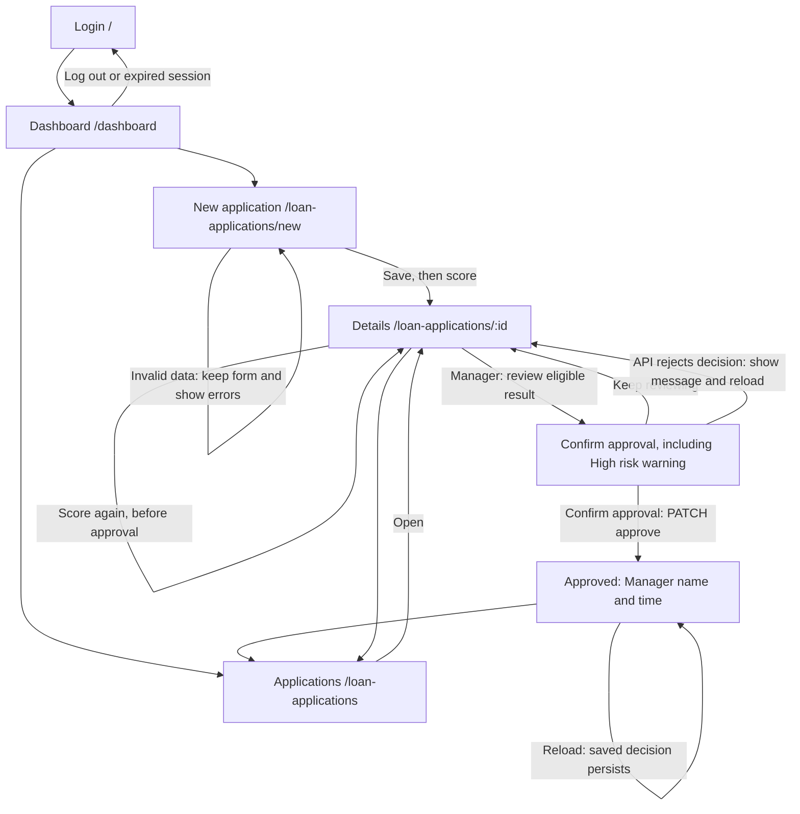

# UI - Credit Scoring Demo (Milestone 3)

How to run the app and which test accounts to use: see [`SETUP.md`](SETUP.md). Screens are React pages (`frontend/src/pages`) that call the FastAPI backend under `/api`.

## 1. P0 stories and status

| Story | Screen(s) | Route | Status | Issue |
| --- | --- | --- | --- | --- |
| US01 Log in with my account | Login | `/` | partly works (implemented; independent browser acceptance pending; log out is a button in the top bar; the 15-minute lock is shown as a message) | #9 |
| US03 Input a loan application | New application | `/loan-applications/new` | partly works (implemented; independent browser acceptance pending; saves, flags High risk when DSR > 50%, scores right away) | #10 |
| US04 View the credit score with explanations | Application details | `/loan-applications/:id` | partly works (implemented; independent browser acceptance pending; score 0-100, label, factors, CIC group; rule-based model `rules-v0`, the trained model comes in Sprint 4) | #11 |
| US08 Overview dashboard | Dashboard | `/dashboard` | partly works (implemented; independent browser acceptance pending; today's total, average score, high-risk count; shows "0 applications today" when empty) | #13 |
| US09 Alert on missing or malformed data | New application | `/loan-applications/new` | partly works (implemented; independent browser acceptance pending; summary box at the top + a message under each wrong field; nothing is saved) | #14 |

Also built, not P0: `/loan-applications` (list, P1, US05 partly) so a person can reach any application without typing a URL.

**Screen flow:** the list is reachable from the top bar/dashboard; Submit and score opens details. The diagram below covers the P0 paths and the Manager approval follow-up. Confirmation and approval remain on the details route; they are not extra pages.



## 2. Wireframes

Each wireframe says why the person comes here and which API endpoints the screen calls.

### 2.1 Login `/`

"The user comes here to sign in with their branch account."
Calls: `POST /api/auth/login`

```
+------------------------------------+
|          Credit Scoring            |
|   Sign in with your branch account |
|  [! Email or password is incorrect.|
|      Check your details ...      ] |   <- shown only after an error
|  Email    [______________________] |
|  Password [______________________] |
|  [          Sign in             ]  |   <- "Signing in..." and disabled while waiting
+------------------------------------+
```


### 2.2 New application `/loan-applications/new`

"The user comes here to enter a customer's loan application and get a credit score."
Calls: `POST /api/loan-applications`, then `POST /api/loan-applications/{id}/score`

```
+-----------------------------------------------+
| New loan application                          |
| [! Please fix these fields:                   |
|    - Monthly income must be a whole number.    |
|    - Loan term must be a whole number. ]       |   <- US09 summary, nothing saved
| Monthly income (VND)        [______________]  |
|   Monthly income must be a whole number.       |   <- red text under the wrong field
| Loan amount (VND)           [______________]  |
| Loan term (months)          [______________]  |
| Estimated monthly payment   [______________]  |
|   (over half of income = High risk)           |
| Loan purpose                [______________]  |
| Credit history              [______________]  |
| CIC debt group (1-5)        [______________]  |
| Citizen ID (optional)       [______________]  |
| Bank account (optional)     [______________]  |
| Numbers encrypted before storage             |
| [ Submit and score ]   <- "Saving the application..." / "Scoring the application..." |
+-----------------------------------------------+
```


### 2.3 Dashboard `/dashboard` (by role, all four states)

"The Officer comes here to see their own activity and create/track applications. The Manager comes here to review branch activity and the backlog, and manage employee access."
Calls: `GET /api/dashboard/summary`; Manager also calls `GET /api/loan-applications` for the review queue. All counters use database data. The daily summary is Vietnam-local today; backlog counts cover all dates.

```text
Officer workspace: My applications overview        [New application]
+ Empty -------------------------+  + Loading ------------------------+
| My activity today: 0 / - / 0   |  | Loading your overview...         |
| 0 applications today.          |  +----------------------------------+
| [New application]              |  + Error --------------------------+
| [My applications]              |  | <API message> [Try again]        |
+-------------------------------+  +----------------------------------+
+ Data ---------------------------------------------------------------+
| My activity today: [3 applications] [75 average] [1 high risk]        |
| Follow my applications -> [My applications]                          |
| Your branch manager makes the approval decision.                    |
+--------------------------------------------------------------------+

Manager workspace: Branch review overview           [Open review queue]
+ Empty -------------------------+  + Loading ------------------------+
| Branch today: 0 / - / 0        |  | Loading branch overview and queue|
| Queue: 0 / 0 / 0               |  +----------------------------------+
| No applications awaiting      |  + Error --------------------------+
| manager review.               |  | <API message> [Try again]        |
| [Manage employees]            |  +----------------------------------+
+-------------------------------+
+ Data ---------------------------------------------------------------+
| Branch today: [total] [average score] [high-risk count]               |
| Manager review queue: ALL DATES                                      |
| [Needs review] [High-risk reviews] [Eligible for decision]            |
| ID / Officer / created time | Loan / score | Review reason | [Review] |
| Up to 8: high risk, manual review, then oldest first                  |
| [View full queue]                     [Manage employees]             |
+--------------------------------------------------------------------+
```

Zero applications today does not clear the Manager backlog. Approved, rejected and cancelled records are excluded from the queue. Eligible means a decision can be made, not automatically approved. Branch applications has risk/eligibility/employee filters; My applications displays the Officer's records without branch controls. Both roles retain navigation to New application because the existing API permits authenticated users to create records.


### 2.4 Application details `/loan-applications/:id`

"The user comes here to read the score, the reasons behind it, and the data the officer entered."
Calls: `GET /api/loan-applications/{id}`, `POST /api/loan-applications/{id}/score`, `PATCH /api/loan-applications/{id}/approve` (Manager), `POST /api/loan-applications/{id}/sensitive-data/reveal` (explicit lookup)

```
+-----------------------------------------------------+
| Application #3f9a1c2e  [Scored]                     |
| [! High risk. Installment is 62.5% of monthly income|
|    ... A manager must review it.]                   |   <- only if DSR > 50%
| Credit score                                        |
|   95 / 100   Eligible for proposal                  |
|   Main factors                                      |
|    - +20: Installment is only 25% of income ...     |
|    - +10: CIC debt group 1 ...                      |
|   [ Score again ]                                   |
| Application data                                    |
|   Monthly income | Loan amount | Term | Purpose ... |
+-----------------------------------------------------+
Other states: Loading ("Loading the application..."), Error ("Application not found..." with
[Try again] and a link back to the list), Rejected (score < 40: "Recommendation Rejected" + the reasons).
```


Manager decision wireframe (Application details, same screen purpose and APIs as section 2.4):

```text
Manager decision
Score is a recommendation; Manager reviews data and reasons.
[Approve application] -> Confirm review (including High risk)
[Confirm approval] [Keep reviewing]
Success: Approved by <manager> on <time>
Officer: Ask your branch manager to review this application.
Ineligible: Review the data and scoring results first.
Error: <API message> and reload current details
```

The Officer sees Manager guidance instead of an approval button. The Manager can
confirm only a latest eligible result (integer score 70-100), for a scored or
manual_review application outside CIC groups 3-5. The High risk flag remains
visible and requires explicit review; it does not disappear when approved.
The saved decision includes Manager name/time, and approval disables rescoring.
Approval records an assessment decision; disbursement is outside this app.
US10 edit/cancel is still pending.

## 3. Error messages

The frontend renders API `detail` in an alert and validation `errors` next to the
corresponding form fields. The strings below match the current backend. Role and
eligibility controls normally prevent invalid approval actions; if a request is
rejected, the details screen shows the API message and reloads the current data.

| API error code | Business rule / trigger | The exact message the user sees |
| --- | --- | --- |
| 401 | US01: incorrect email/password | Email or password is incorrect. Check your details and try again. |
| 423 | US01: sign-in attempted during the 15-minute lock | Too many wrong passwords. Your account is locked for 15 minutes. Try again later or ask your manager to help. |
| 422 | BR2: monthly income is zero or negative | Monthly income must be greater than 0 VND. |
| 422 | US09: monthly income is not a whole number | Monthly income must be a whole number. |
| 429 | BR5: fourth scoring result requested in the rolling hour | This application has already been scored 3 times in the last hour. It is now marked 'Requires manager review'. Ask a manager to review it. |
| 403 | Approval authorization: actor is not Admin | Only a manager can approve a loan application. Ask your manager to review this application. |
| 409 | Approval: cancelled, rejected or already approved | This application is cancelled, rejected or already approved. Select an application awaiting approval. |
| 409 | Approval / BR4 / BR6: no valid latest eligible result | This application needs a valid eligible score before approval. Review its data and scoring results first. |
| 409 | Approval: application changed during review | This application changed while you were reviewing it. Reload the details before deciding. |

## 4. What changed since M2

### Design change: a recommendation needs a separate Manager decision

Building Application details exposed the need to distinguish a model recommendation
from a Manager's recorded decision. An eligible score does not change the loan
to approved. The interface now offers Admin-only review and confirmation, backed
by `PATCH /api/loan-applications/{id}/approve`. The backend commits the approved
status and `loan.approved` audit together; detail responses expose
`approval.actor_id`, `approval.actor_name` and `approval.approved_at` so the user
can see who made the decision and when, including after reload. The High risk flag
is preserved. These API and response-contract details are updated in
[design.md, Manager approval contract](design.md#manager-approval-contract) in the
same change. The existing broader M2-to-M3 changes remain in
[design.md section 7](design.md#7-what-changed-since-m2).

### Design change: role-focused workspaces

The shared Dashboard did not make clear what an Officer or a Manager should do next. Officer now sees My activity, My applications and a primary New application action. Manager sees a Branch overview, a database-backed review queue across all dates, review/high-risk/eligible filters, a Created by employee filter and a Manage employees shortcut. The details page names the current role and highlights the Manager's approval decision. No API rule changed: BR8 (Officer sees own records, Manager sees all) is still enforced by the backend, and the interface does not create any permission. See [design.md section 12](design.md#12-role-specific-entry-points-and-manager-backlog).

| | Officer | Manager |
| --- | --- | --- |
| Navigation | My dashboard, My applications, New application | Branch overview, Branch applications, New application, Employees |
| Data scope | Own applications only (daily metrics and list) | Branch daily metrics; review queue across all dates; all employees' applications |
| Details | Can score; sees who makes the approval decision | Can approve an eligible score after confirmation |
| Not available | Approval, branch filters, Employees | Changing Manager accounts |

US07 notifications, US06 history UI and US10 edit/cancel remain pending; the review queue is not a notification feature.

### Officer and Manager comparison in the browser

Run [SETUP.md section 13](SETUP.md#13-compare-officer-and-manager-workspaces) from the updated checkout and fill the table from what you actually see. Keep the address bar visible in every screenshot and save the images in `images/ui/`.

| Check | Expected | Result | Tester / date | Screenshot |
| --- | --- | --- | --- | --- |
| Hoang (Officer): navigation and dashboard | My dashboard, My applications, no Employees | pending | | |
| Hoang: list | Only Hoang's applications, no branch filters | pending | | |
| Thanh (Manager): navigation and dashboard | Branch overview, Employees, review queue with earlier-day records | pending | | |
| Thanh: filters | Review / high-risk / eligible and Created by combine; URL keeps the view | pending | | |
| Thanh approves an eligible record | Status Approved with Manager name and time; reload keeps it | pending | | |
| Approved record leaves the queue | Reopen the queue: the approved record is not listed | pending | | |

### Database data and acceptance evidence

The running interface uses saved `loan_applications`, `scoring_results` and
`event_logs` through authenticated APIs. Seed values are synthetic demonstration
data persisted in the database; new applications and approval decisions are also
persisted. The wireframe numbers above are illustrative, not running-app evidence.

Follow [SETUP.md section 11](SETUP.md#11-manager-approval-demo) through the interface:

1. As Hoang, create and score an application using the documented demo values;
   open it from the application list without typing a details URL.
2. Sign out and sign in as Thanh. Open the same record from the list/review queue,
   review its input, score and reasons, then choose **Approve application** and
   **Confirm approval**.
3. Reload and verify **Approved**, Manager name/time and the saved data persist.
   Verify that an Officer has no approval action and that an approved application
   cannot be scored again. Approval does not imply disbursement.
4. On New application, submit monthly income `0` with other required fields valid;
   verify the BR2 message and that no new application was created.
5. Capture the running data/decision screen and the visible business-rule error,
   keeping the browser address bar visible. Save actual captures in `images/ui/`
   and link them here with tester, date and observed result.

**Evidence status:** browser acceptance and screenshots are pending. No running-app
screenshots have been added in this documentation change. The 17 approval API
checks in `backend/tests/test_approval.py` passed locally on 2026-10-18; this does
not establish browser acceptance, GitHub CI, teammate review or completion of US10.
