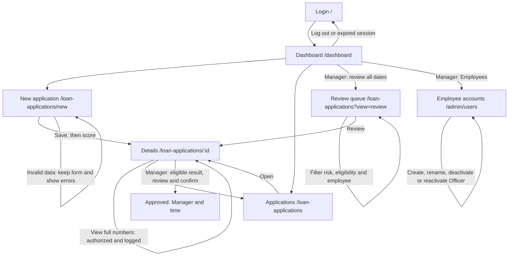

# UI - Credit Scoring Demo (Milestone 3)

How to run the app and which test accounts to use: see [`SETUP.md`](SETUP.md). Screens are React pages (`frontend/src/pages`) that call the FastAPI backend under `/api`.

## 1. P0 stories and status

| Story | Screen(s) | Route | Status | Issue |
| --- | --- | --- | --- | --- |
| US01 Log in with my account | Login | `/` | partly works (implemented; independent browser acceptance pending; log out is a button in the top bar; the 15-minute lock is shown as a message) | #9 |
| US03 Input a loan application | New application | `/loan-applications/new` | partly works (implemented; independent browser acceptance pending; saves, flags High risk when DSR > 50%, scores right away) | #10 |
| US04 View the credit score with explanations | Application details | `/loan-applications/:id` | partly works (implemented; independent browser acceptance pending; score 0-100, label, factors, CIC group; rule-based model `rules-v0`, the trained model comes in Sprint 4) | #11 |
| US08 Overview dashboard | Dashboard | `/dashboard` | partly works (implemented; independent browser acceptance pending; today's total, average score, high-risk count; shows "0 applications today" when empty) | #13 |
| US09 Alert on missing or malformed data | New application | `/loan-applications/new` | partly works (implemented; independent browser acceptance pending; summary box at the top + a message under each wrong field; nothing is saved) | #14 |

Also built, not P0: `/loan-applications` (list, P1, US05 partly) so a person can reach any application without typing a URL.

**Screen flow (updated from M1):** the list is reachable from the top bar/dashboard; Submit and score opens details. Manager navigation now includes Employees (`/admin/users`), and details includes protected identifier lookup.



## 2. Wireframes

Each wireframe says why the person comes here and which API endpoints the screen calls.

### 2.1 Login `/`

"The user comes here to sign in with their branch account."
Calls: `POST /api/auth/login`

```
+------------------------------------+
|          Credit Scoring            |
|   Sign in with your branch account |
|  [! Email or password is incorrect.|
|      Check your details ...      ] |   <- shown only after an error
|  Email    [______________________] |
|  Password [______________________] |
|  [          Sign in             ]  |   <- "Signing in..." and disabled while waiting
+------------------------------------+
```


### 2.2 Dashboard `/dashboard` (by role, all four states)

"The Officer comes here to see their own activity and create/track applications. The Manager comes here to review branch activity and the backlog, and manage employee access."
Calls: `GET /api/dashboard/summary`; Manager also calls `GET /api/loan-applications` for the review queue. All counters use database data. The daily summary is Vietnam-local today; backlog counts cover all dates.

```text
Officer workspace: My applications overview        [New application]
+ Empty -------------------------+  + Loading ------------------------+
| My activity today: 0 / - / 0   |  | Loading your overview...         |
| 0 applications today.          |  +----------------------------------+
| [New application]              |  + Error --------------------------+
| [My applications]              |  | <API message> [Try again]        |
+-------------------------------+  +----------------------------------+
+ Data ---------------------------------------------------------------+
| My activity today: [3 applications] [75 average] [1 high risk]        |
| Follow my applications -> [My applications]                          |
| Your branch manager makes the approval decision.                    |
+--------------------------------------------------------------------+

Manager workspace: Branch review overview           [Open review queue]
+ Empty -------------------------+  + Loading ------------------------+
| Branch today: 0 / - / 0        |  | Loading branch overview and queue|
| Queue: 0 / 0 / 0               |  +----------------------------------+
| No applications awaiting      |  + Error --------------------------+
| manager review.               |  | <API message> [Try again]        |
| [Manage employees]            |  +----------------------------------+
+-------------------------------+
+ Data ---------------------------------------------------------------+
| Branch today: [total] [average score] [high-risk count]               |
| Manager review queue: ALL DATES                                      |
| [Needs review] [High-risk reviews] [Eligible for decision]            |
| ID / Officer / created time | Loan / score | Review reason | [Review] |
| Up to 8: high risk, manual review, then oldest first                  |
| [View full queue]                     [Manage employees]             |
+--------------------------------------------------------------------+
```

Zero applications today does not clear the Manager backlog. Approved, rejected and cancelled records are excluded from the queue. Eligible means a decision can be made, not automatically approved. Branch applications has risk/eligibility/employee filters; My applications displays the Officer's records without branch controls. Both roles retain navigation to New application because the existing API permits authenticated users to create records.

### 2.3 New application `/loan-applications/new`

"The user comes here to enter a customer's loan application and get a credit score."
Calls: `POST /api/loan-applications`, then `POST /api/loan-applications/{id}/score`

```
+-----------------------------------------------+
| New loan application                          |
| [! Please fix these fields:                   |
|    - Income is required                       |
|    - Loan term is required ]                  |   <- US09 summary, nothing saved
| Monthly income (VND)        [______________]  |
|   Income is required                          |   <- red text under the wrong field
| Loan amount (VND)           [______________]  |
| Loan term (months)          [______________]  |
| Estimated monthly payment   [______________]  |
|   (over half of income = High risk)           |
| Loan purpose                [______________]  |
| Credit history              [______________]  |
| CIC debt group (1-5)        [______________]  |
| Citizen ID (optional)       [______________]  |
| Bank account (optional)     [______________]  |
| Numbers encrypted before storage             |
| [ Submit and score ]   <- "Saving the application..." / "Scoring the application..." |
+-----------------------------------------------+
```


### 2.4 Application details `/loan-applications/:id`

"The user comes here to read the score, the reasons behind it, and the data the officer entered."
Calls: `GET /api/loan-applications/{id}`, `POST /api/loan-applications/{id}/score`, `PATCH /api/loan-applications/{id}/approve` (Manager), `POST /api/loan-applications/{id}/sensitive-data/reveal` (explicit lookup)

```
+-----------------------------------------------------+
| Application #3f9a1c2e  [Scored]                     |
| [! High risk. Installment is 62.5% of monthly income|
|    ... A manager must review it.]                   |   <- only if DSR > 50%
| Credit score                                        |
|   95 / 100   Eligible for proposal                  |
|   Main factors                                      |
|    - +20: Installment is only 25% of income ...     |
|    - +10: CIC debt group 1 ...                      |
|   [ Score again ]                                   |
| Application data                                    |
|   Monthly income | Loan amount | Term | Purpose ... |
+-----------------------------------------------------+
Other states: Loading ("Loading the application..."), Error ("Application not found..." with
[Try again] and a link back to the list), Rejected (score < 40: "Recommendation Rejected" + the reasons).
```


Manager decision wireframe (Application details, same screen purpose and APIs as section 2.4):

```text
Manager decision
Score is a recommendation; Manager reviews data and reasons.
[Approve application] -> Confirm review (including High risk)
[Confirm approval] [Keep reviewing]
Success: Approved by <manager> on <time>
Officer: Ask your branch manager to review this application.
Ineligible: Review the data and scoring results first.
Error: <API message> and reload current details
```

### 2.5 Protected identifiers (on application details)

"The user comes here to check the customer identifiers for an application they are permitted to open."
Calls: `POST /api/loan-applications/{id}/sensitive-data/reveal`.

```text
Protected identifiers
Citizen ID: ********7890       Bank account: ********0123
[View full numbers (logged)] -> Opening... -> full values + [Hide numbers]
No values: Not provided. Error: API message, retry available.
Numbers hide after 30 seconds, when the window loses focus or the tab is hidden.
```

### 2.6 Employee accounts `/admin/users` (Manager only)

"The user comes here to create Officer accounts and control employee access while retaining loan history."
Calls: GET/POST `/api/admin/users`, PATCH `/api/admin/users/{id}`.

```text
Employee accounts
Create Officer: [Name] [Email] [Initial password, 12–128 chars] [Create Officer]
Loading: Loading employees...   Empty: No employee accounts.
Error: <API message> [Try again]
Data: Name, email, Officer/Manager, Active/Inactive
Officer: [Name] [Save name] [Deactivate / Reactivate]
Confirm: <effect on access and retained records> [Confirm] [Keep current status]
Manager: Manager accounts cannot be changed here.
```

## 3. Error messages

| API code | Rule | The user sees |
| --- | --- | --- |
| `401` | US01 | "Email or password is incorrect. Check your details and try again." |
| `423` | US01 (3 wrong passwords) | "Too many wrong passwords. Your account is locked for 15 minutes. Try again later or ask your manager to help." |
| `422` | BR2 (income must be > 0) | "Monthly income must be greater than 0 VND. Enter the customer's real monthly income and submit again." |
| `422` | US09 (missing or malformed field) | "Please fix these fields:" then one line per field, e.g. "Income is required", "Income must be a whole number", "Loan term is required" |
| `429` | BR5 (3 scorings per hour) | "This application has already been scored 3 times in the last hour. It is now marked 'Requires manager review'. Ask a manager to review it." |
| `403` | BR8 (own applications only) | "You can only open applications you created. Ask your manager if you need access to this one." |
| `404` | US05 | "Application not found. It may have been removed. Check the link or go back to the list." |
| `409` | US10 (cancelled or approved) | "This application is cancelled or already approved, so it cannot be scored again. Go back to the list or ask your manager for help." |
| `401` (token expired) | US01 | "Your session has expired. Please sign in again." (shown on the login screen) |
| `503` | BR7 audit unavailable | "Access could not be recorded, so protected numbers were not opened. Try again or ask your administrator for help." |
| `403` | BR8 account management | "Only a manager can manage employee accounts. Ask your branch manager for help." |
| `403` | BR8 inactive account | "This employee account is inactive. Ask your manager to reactivate it." |
| `409` | BR8 duplicate account | "An account already uses this email. Use another email or update the existing employee." |
| no answer | - | "We can't reach the server. Check your connection and try again." |
| `201` (not an error) | BR4 (CIC group 3-5) | Score shows "-", label "Recommendation Rejected", reason: "CIC debt group 4 (bad debt). Groups 3-5 are rejected automatically." |
| `201` (not an error) | BR1 (score out of range) | "The model returned an invalid score, so no score is shown. A manager will review this application." |

## 4. What changed since M2

1. **`POST /api/loan-applications` returns the errors per field.** Building the form showed that one sentence is not enough to point at the wrong input. A `422` now returns `{"detail": "<message>", "errors": {"monthly_income": "Income is required", ...}}`; `detail` stays a string, so the M2 convention still holds. Also changed in `design.md` section 3.
2. **Scoring is a rule-based stand-in (`rules-v0`) in Sprint 3.** The screens need a real score before the trained model exists (Sprint 4). It keeps the same interface (features in, score and reasons out), so Sprint 4 only swaps `predict`.
3. **`GET /api/dashboard/summary` also returns `date` and `high_risk_count`**, and `GET /api/auth/me` was added so the app can read the current user. Both are in `design.md` section 3. "Today" follows Vietnam time (UTC+7).
4. **BR7/BR8 are built:** optional encrypted identifiers, masked/audited lookup and Manager-only Employees screen. US10 edit/cancel, US06 history UI and US07 notifications remain pending.


5. **BR8 applies to the old M2 HTML page too.** `/loan-applications` on the API port now requires a bearer token and filters by owner. Use the React interface on port 5173 for the demo; no financial data is publicly exposed.
6. **BR5 runs before BR4**, so CIC-rejected results also count toward the three-result hourly limit.
7. **US03 state mapping:** the persisted `pending` value means "Scoring in progress" on screen. Creation and scoring are separate requests; if scoring fails, the saved application remains accessible with a retry button.

Release evidence still required: actual GitHub board URL, review/approval/merge, browser acceptance, clean-machine tester, board screenshots, app screenshots with address bar, and `Team04_M3.pdf`.


8. **Manager approval is implemented.** Details includes Manager decision, Approve application, confirmation, and persisted approver/time. Officer sees who must approve; Manager sees eligibility or the reason approval is unavailable. No score automatically sets approved. See design.md section 10. Additional messages: 403 "Only a manager can approve a loan application. Ask your manager to review this application."; 409 "This application needs a valid eligible score before approval. Review its data and scoring results first." Approval browser acceptance is pending.

9. **BR7/BR8 completion:** design.md section 11 documents the new identifier fields, encryption key, additive schema migration, audited reveal API and account management. New application clears entered identifiers after saving; details masks by default, and lookup failures are shown with recovery instructions. Employee status changes revoke old sessions without removing their loans.

10. **Role-focused workspaces:** the shared Dashboard was insufficiently clear about Officer vs Manager tasks. Officer now has My activity/My applications and a primary New application action. Manager has Branch overview, a database-backed all-date review queue, filters and a Manage employees shortcut. Details explains the current role and highlights the Manager's approval decision. No API authorization rule was weakened; BR8 remains enforced on the backend. See design.md section 12.

## 5. Running-app screenshots


