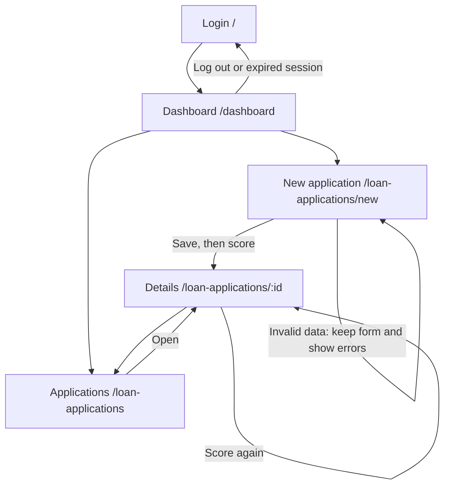

# UI - Credit Scoring Demo (Milestone 3)

How to run the app and which test accounts to use: see [`SETUP.md`](SETUP.md). Screens are React pages (`frontend/src/pages`) that call the FastAPI backend under `/api`.

## 1. P0 stories and status

| Story | Screen(s) | Route | Status | Issue |
| --- | --- | --- | --- | --- |
| US01 Log in with my account | Login | `/` | partly works (implemented; independent browser acceptance pending; log out is a button in the top bar; the 15-minute lock is shown as a message) | #9 |
| US03 Input a loan application | New application | `/loan-applications/new` | partly works (implemented; independent browser acceptance pending; saves, flags High risk when DSR > 50%, scores right away) | #10 |
| US04 View the credit score with explanations | Application details | `/loan-applications/:id` | partly works (implemented; independent browser acceptance pending; score 0-100, label, factors, CIC group; rule-based model `rules-v0`, the trained model comes in Sprint 4) | #11 |
| US08 Overview dashboard | Dashboard | `/dashboard` | partly works (implemented; independent browser acceptance pending; today's total, average score, high-risk count; shows "0 applications today" when empty) | #13 |
| US09 Alert on missing or malformed data | New application | `/loan-applications/new` | partly works (implemented; independent browser acceptance pending; summary box at the top + a message under each wrong field; nothing is saved) | #14 |

Also built, not P0: `/loan-applications` (list, P1, US05 partly) so a person can reach any application without typing a URL.

**Screen flow:** the list is reachable from the top bar/dashboard; Submit and score opens details. The diagram below covers the P0 paths in this branch.

