# UI - Credit Scoring Demo

## 1. P0 stories and status

| Story | Screen(s) | Route | Status | Issue |
| --- | --- | --- | --- | --- |
| US01 Log in with my account | Login | `/` | partly works (implemented; independent browser acceptance pending; log out is a button in the top bar; the 15-minute lock is shown as a message) | #9 |
| US03 Input a loan application | New application | `/loan-applications/new` | partly works (implemented; independent browser acceptance pending; saves, flags High risk when DSR > 50%, scores right away) | #10 |
| US04 View the credit score with explanations | Application details | `/loan-applications/:id` | partly works (implemented; independent browser acceptance pending; score 0-100, label, factors, CIC group; rule-based model `rules-v0`, the trained model comes in Sprint 4) | #11 |
| US08 Overview dashboard | Dashboard | `/dashboard` | partly works (implemented; independent browser acceptance pending; today's total, average score, high-risk count; shows "0 applications today" when empty) | #13 |
| US09 Alert on missing or malformed data | New application | `/loan-applications/new` | partly works (field errors and no-save behavior implemented; API required-income wording fixed in S4-05; independent browser acceptance pending) | #14 |

Also built, not P0: `/loan-applications` (list, P1, US05 partly) so a person can reach any application without typing a URL.

**Screen flow (updated from M1):** people reach application records from the navigation, list or Manager review queue without typing a details URL.

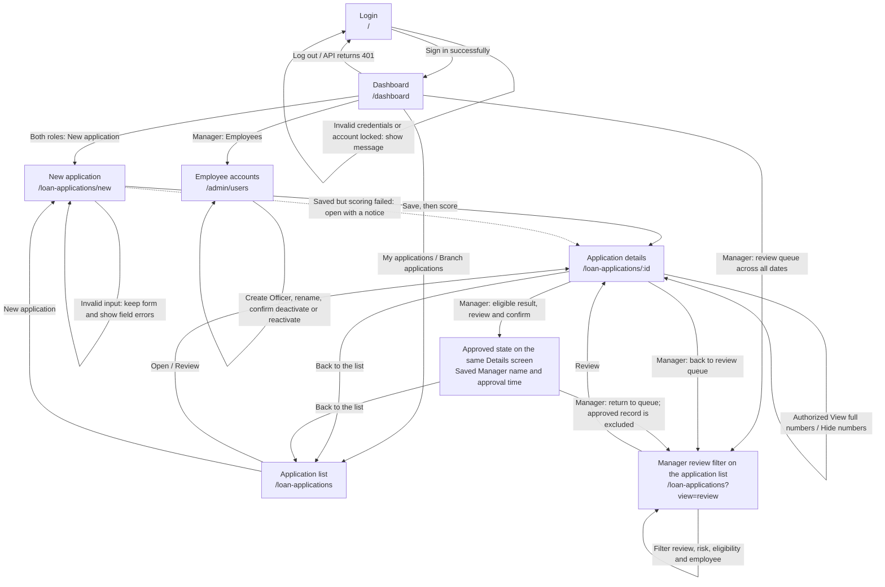

Both roles can create applications and use the top bar to return to the dashboard or list. The review queue is a Manager filter of the application list; Approved is a persisted state of Application details. Scoring is a recommendation, followed by a separate Manager decision. The backend enforces ownership and Manager-only actions. Log out from any protected page, or an API response of 401 for an expired/invalid session, returns the user to Login. Full identifiers hide after 30 seconds, window blur or tab hiding.

## 2. Wireframes

Each wireframe says why the person comes here and which API endpoints the screen calls.

### 2.1 Login `/`

"The user comes here to sign in with their branch account."
Calls: `POST /api/auth/login`

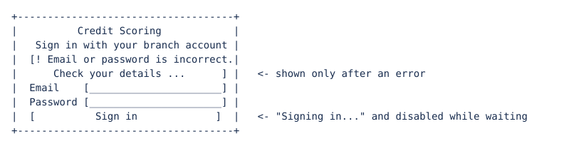

### 2.2 Dashboard `/dashboard` (by role, all four states)

"The Officer comes here to see their own activity and create/track applications. The Manager comes here to review branch activity and the backlog, and manage employee access."
Calls: `GET /api/dashboard/summary`; Manager also calls `GET /api/loan-applications` for the review queue. All counters use database data. The daily summary is Vietnam-local today; backlog counts cover all dates.

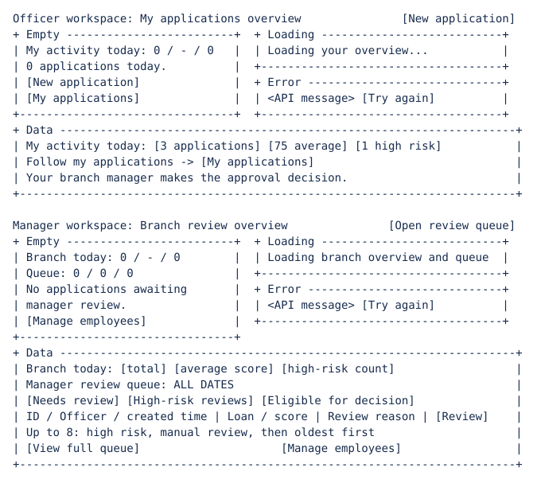

Zero applications today does not clear the Manager backlog. Approved, rejected and cancelled records are excluded from the queue. Eligible means a decision can be made, not automatically approved. Branch applications has risk/eligibility/employee filters; My applications displays the Officer's records without branch controls. Both roles retain navigation to New application because the existing API permits authenticated users to create records.

### 2.3 New application `/loan-applications/new`

"The user comes here to enter a customer's loan application and get a credit score."
Calls: `POST /api/loan-applications`, then `POST /api/loan-applications/{id}/score`

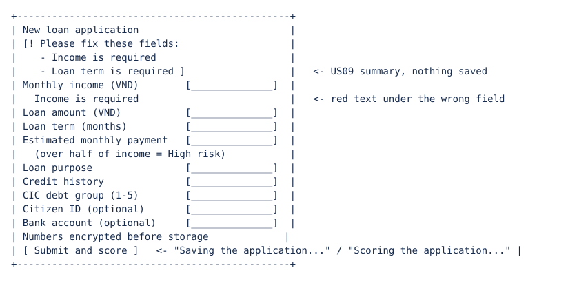

The wireframe preserves the required-field design. S4-05 makes an empty, blank,
missing or null income return "Income is required" from the API; malformed numeric
input returns "Monthly income must be a whole number." The API saves nothing on
validation failure. Independent browser acceptance and a new error capture remain pending.

### 2.4 Application details `/loan-applications/:id`

"The user comes here to read the score, the reasons behind it, and the data the officer entered."
Calls: `GET /api/loan-applications/{id}`, `POST /api/loan-applications/{id}/score`, `PATCH /api/loan-applications/{id}/approve` (Manager), `POST /api/loan-applications/{id}/sensitive-data/reveal` (explicit lookup)

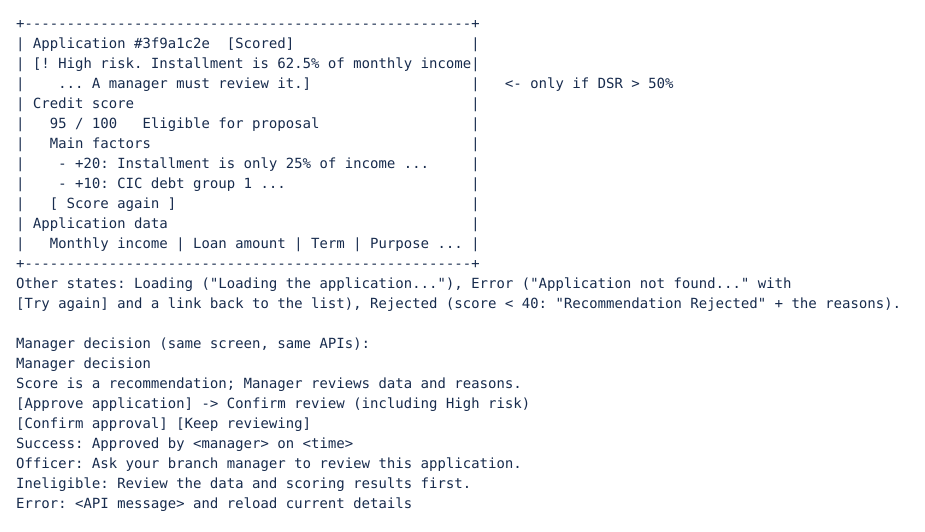

Manager decision wireframe (Application details, same screen purpose and APIs)

### 2.5 Protected identifiers (on application details)

"The user comes here to check the customer identifiers for an application they are permitted to open."
Calls: `POST /api/loan-applications/{id}/sensitive-data/reveal`.

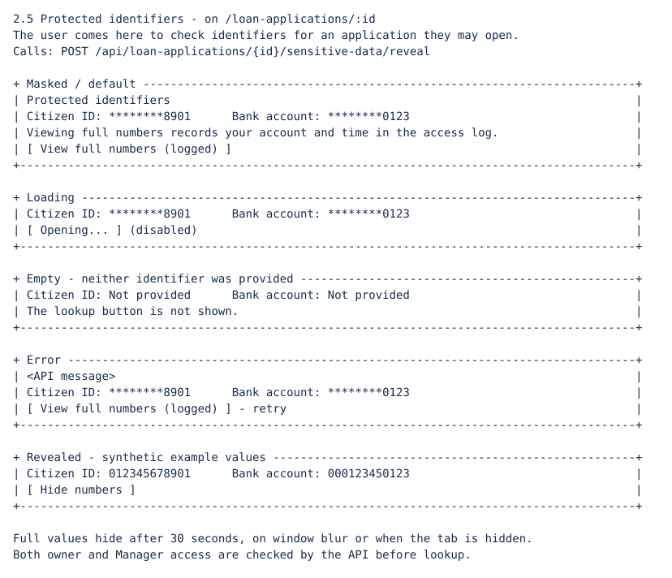

### 2.6 Employee accounts `/admin/users` (Manager only)

"The user comes here to create Officer accounts and control employee access while retaining loan history."
Calls: GET/POST `/api/admin/users`, PATCH `/api/admin/users/{id}`.

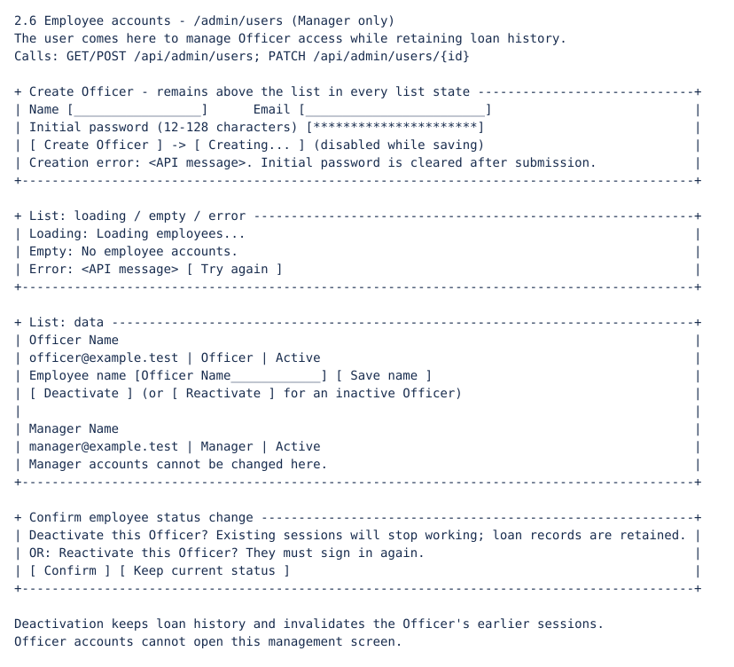

## 3. Error messages

These are the exact strings currently used by the backend or the frontend.
For validation, the API returns `detail` plus per-field `errors`. With multiple
field errors the form shows "Please fix these fields:" and the field messages;
with one field error it shows the API detail "Please correct the highlighted
fields and submit again." and the message beside the field.

| API code | Rule | The user sees |
| --- | --- | --- |
| `401` | US01 | "Email or password is incorrect. Check your details and try again." |
| `423` | US01 (request while locked after 3 wrong passwords) | "Too many wrong passwords. Your account is locked for 15 minutes. Try again later or ask your manager to help." |
| `422` | BR2 (income equals 0) | "Monthly income must be greater than 0 VND." |
| `422` | US09 (nonnumeric or malformed income text) | "Monthly income must be a whole number." |
| `422` | US09 (missing, empty, whitespace-only or null income) | "Income is required" |
| `422` | BR9 (payment exceeds loan amount) | "Estimated monthly payment must not exceed the loan amount." |
| `422` | BR9 (payment x term does not cover loan amount) | "Estimated monthly payment multiplied by the loan term must cover the loan amount." |
| `422` | BR7 (invalid Citizen ID format) | "Citizen ID must be 9 or 12 digits, with no spaces, letters or separators." |
| `422` | BR7 (invalid bank account format) | "Bank account must be 6 to 20 digits, with no spaces, letters or separators." |
| `429` | BR5 (fourth scoring request in the rolling hour) | "This application has already been scored 3 times in the last hour. It is now marked 'Requires manager review'. Ask a manager to review it." |
| `403` | BR8 (own applications only) | "You can only open applications you created. Ask your manager if you need access to this one." |
| `404` | US05 (application does not exist) | "Application not found. Check the link or return to the list." |
| `409` | Scoring an approved or cancelled application | "This application is cancelled or already approved, so it cannot be scored again. Go back to the list or ask your manager for help." |
| `403` | Approval is Manager-only | "Only a manager can approve a loan application. Ask your manager to review this application." |
| `409` | Approval state is cancelled, rejected or approved | "This application is cancelled, rejected or already approved. Select an application awaiting approval." |
| `409` | Latest result is not eligible for approval | "This application needs a valid eligible score before approval. Review its data and scoring results first." |
| `409` | Application changes during approval | "This application changed while you were reviewing it. Reload the details before deciding." |
| `401` (missing token) | US01 | "Please sign in to continue." |
| `401` (expired/invalid/revoked token) | US01 | "Your session has expired. Please sign in again." (shown on the login screen) |
| `503` | BR7 encryption key unavailable or invalid | "Identifier protection is not configured. Ask the administrator to run python -m app.init_secrets and restart the server." |
| `503` | BR7 saved data cannot be decrypted | "The saved identifier cannot be opened with the configured key. Ask the administrator to restore the original encryption key." |
| `503` | BR7 audit unavailable | "Access could not be recorded, so protected numbers were not opened. Try again or ask your administrator for help." |
| `403` | BR8 account management | "Only a manager can manage employee accounts. Ask your branch manager for help." |
| `403` | BR8 inactive account at login | "This employee account is inactive. Ask your manager to reactivate it." |
| `409` | BR8 duplicate account | "An account already uses this email. Use another email or update the existing employee." |
| no response | Network unavailable | "We can't reach the server. Check your connection and try again." |
| no response within 15 seconds | Request timeout | "The server took too long to respond. Check the applications list before retrying, then try again." |
| `201` (not an error) | BR4 (CIC group 4 example) | Score shows "-", label "Recommendation Rejected", reason: "CIC debt group 4 (bad debt). Groups 3-5 are rejected automatically." |
| `201` (not an error) | BR1 (score out of range) | "The model returned an invalid score, so no score is shown. A manager will review this application." |

**S4-05 API validation:** an empty income string now follows the required-field
branch and returns exactly "Income is required". Whitespace-only, null and omitted
income use the same message. Regression tests cover these inputs, BR9 and no-save
behavior. Automated API results do not establish independent browser acceptance.

## 4. What changed since M2

### Design change: a recommendation needs a separate Manager decision

Building Application details exposed the need to distinguish a model recommendation
from a Manager's recorded decision. An eligible score does not change the loan
to approved. The interface now offers Admin-only review and confirmation, backed
by `PATCH /api/loan-applications/{id}/approve`. The backend commits the approved
status and `loan.approved` audit together; detail responses expose
`approval.actor_id`, `approval.actor_name` and `approval.approved_at` so the user
can see who made the decision and when, including after reload. The High risk flag
is preserved.

### Design change: role-focused workspaces

The shared Dashboard did not make clear what an Officer or a Manager should do next. Officer now sees My activity, My applications and a primary New application action. Manager sees a Branch overview, a database-backed review queue across all dates, review/high-risk/eligible filters, a Created by employee filter and a Manage employees shortcut. The details page names the current role and highlights the Manager's approval decision. No API rule changed: BR8 (Officer sees own records, Manager sees all) is still enforced by the backend, and the interface does not create any permission.

| | Officer | Manager |
| --- | --- | --- |
| Navigation | My dashboard, My applications, New application | Branch overview, Branch applications, New application, Employees |
| Data scope | Own applications only (daily metrics and list) | Branch daily metrics; review queue across all dates; all employees' applications |
| Details | Can score; sees who makes the approval decision | Can approve an eligible score after confirmation |
| Not available | Approval, branch filters, Employees | Changing Manager accounts |

US07 notifications, US06 history UI and US10 edit/cancel remain pending; the review queue is not a notification feature.

**Evidence status:** five running-app screenshots are included below.

### Running-app screenshots

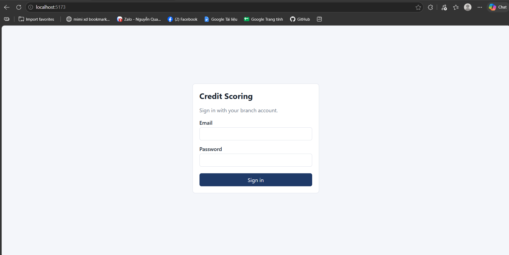

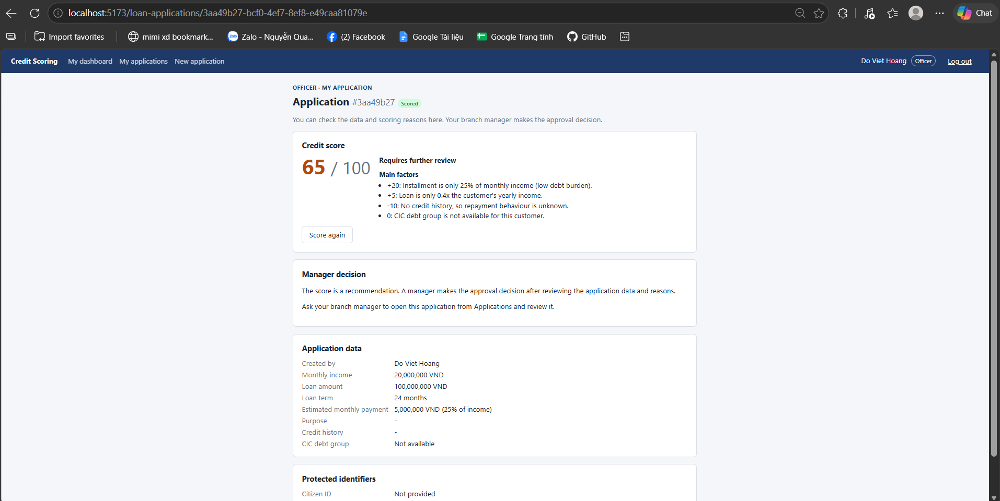

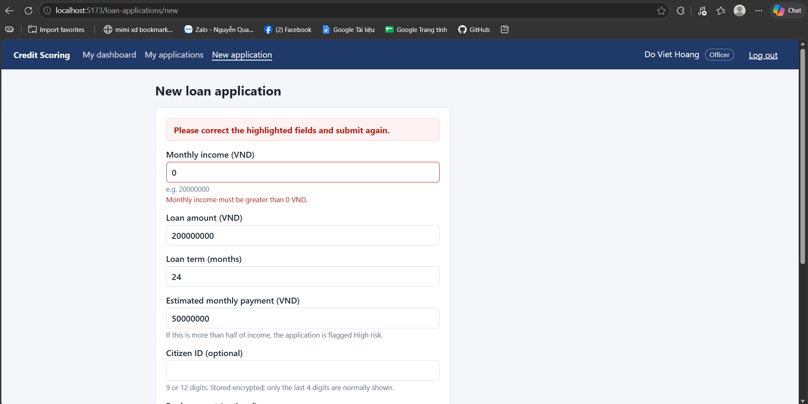

This existing Sprint 3 capture is historical evidence; it is not a new capture proving the S4-05 message.

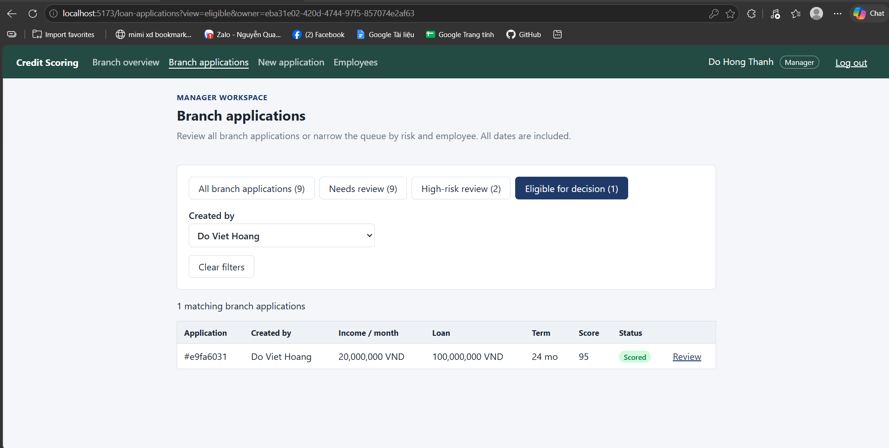

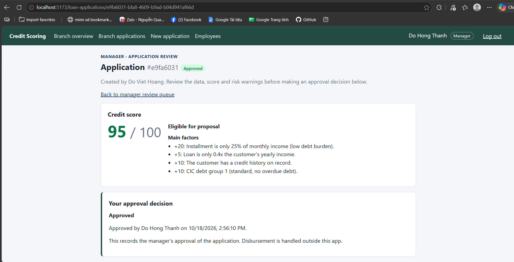

### P0 completion in this copy (2026-10-29)

All five P0 stories have their implementation and local browser verification.
`NewApplication.jsx` opens the saved record before requesting the score from
`ApplicationDetail.jsx`. This exposes the stored `pending` status (Scoring in
progress) and BR3 warning while scoring is slow. The request is consumed once,
including under React StrictMode and after reload. A scoring error leaves the
record accessible with Get credit score; retry does not create a second loan.
Login mirrors the API's nonblank/254/128 limits, names invalid fields and preserves
the entered password. The current scoring engine is the deterministic `rules-v1`.

The seven tests in `frontend/browser/p0.spec.js` ran in real headless Microsoft Edge
against this copy's FastAPI and a newly seeded temporary SQLite database. Form
submissions, reads, scoring and Dashboard totals use persisted data. One scoring
request is deliberately held to inspect pre-score state, and one is deliberately
answered with 503 to exercise recovery; those controlled errors are not claims
about a live service outage. No existing database, key or account was changed.

| Check | Observed local result |
| --- | --- |
| US01 correct credentials to Dashboard | 953 ms (requirement < 2000 ms); three wrong passwords and locked response also checked |
| US03 Submit to persisted details | 93 ms (requirement < 3000 ms), with scoring deliberately held |
| US04 low score and normal result | Rejected result has at least two reasons; normal result 95 with CIC group 1; list navigation and reload retain it |
| US08 daily data | Empty state, then 10 real GUI-created applications and average score 95; Manager workspace also opens |
| US09 invalid input | Exact required/text/zero-income messages, no create request and unchanged stored row count; keyboard focus and 375 px viewport checked |

These are local automated checks on one machine, not independent human sign-off,
fresh-clone evidence, GitHub CI status or a performance guarantee for other machines.
The viewport captures below do not contain browser chrome/address bars; prepare
the separately required address-bar screenshots for the LMS submission.

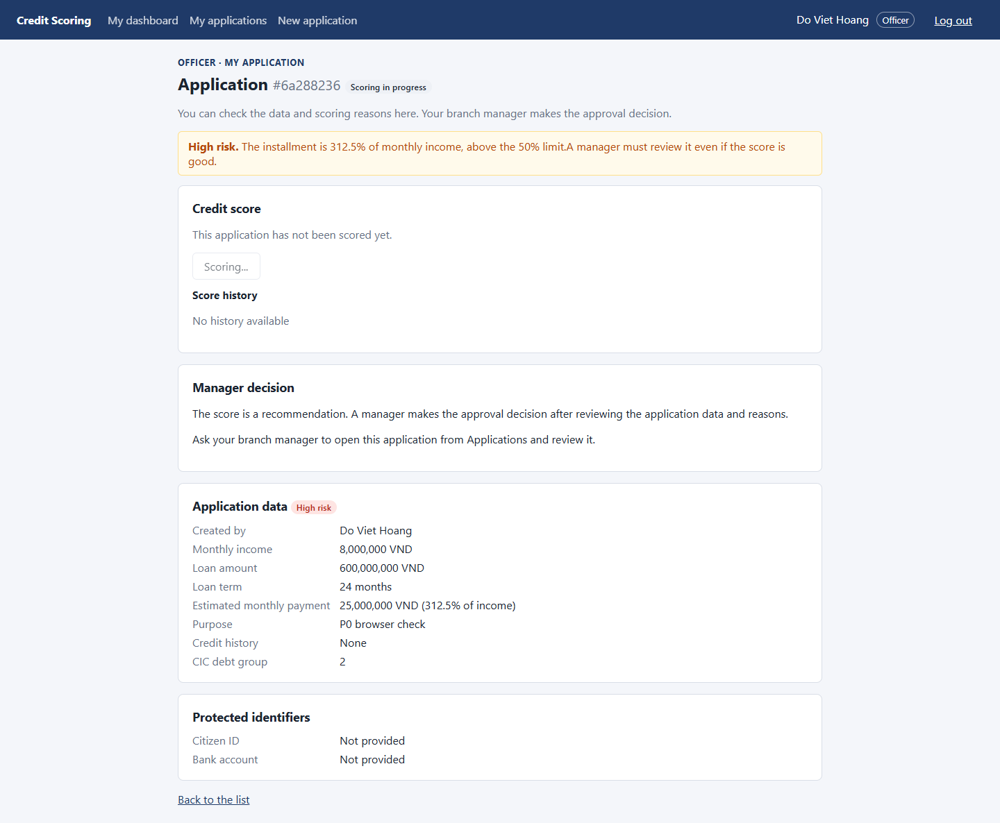

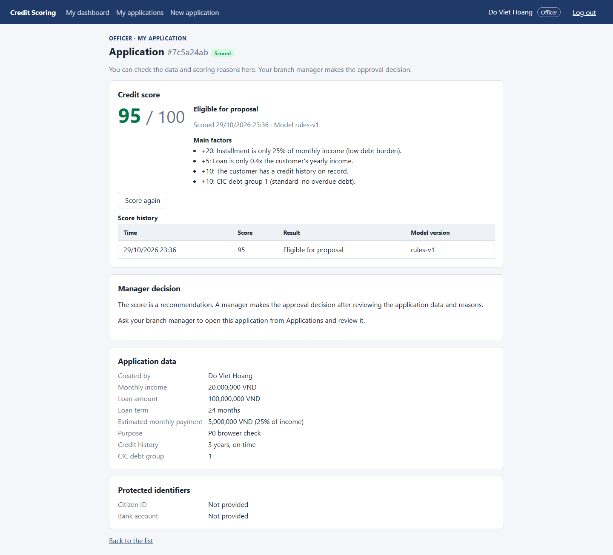

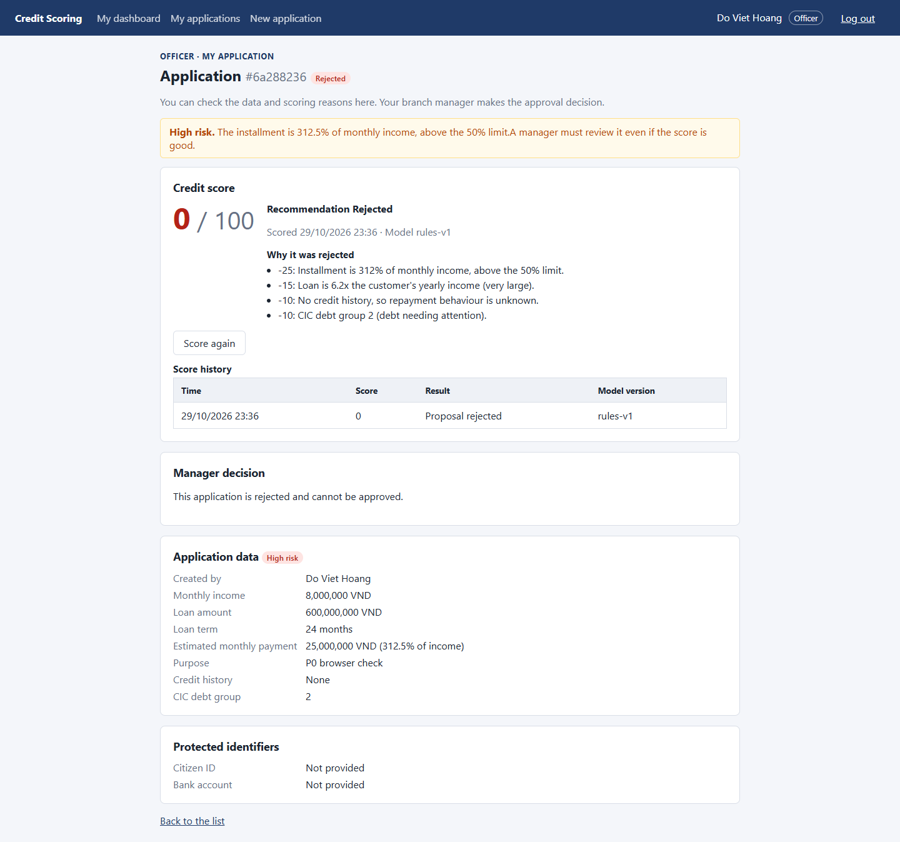

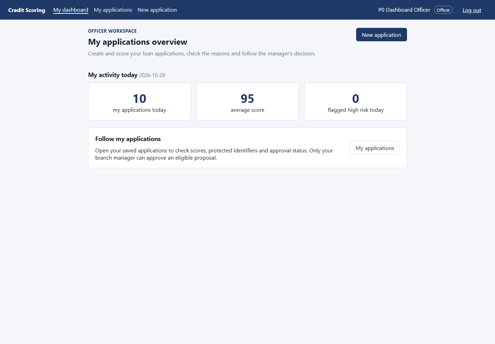

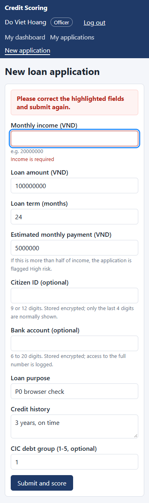
