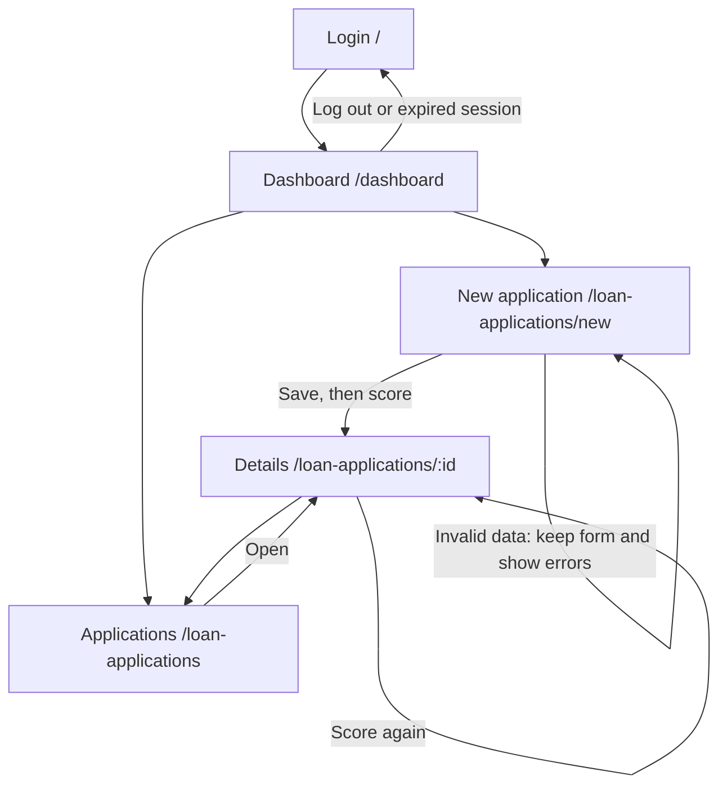

# UI - Credit Scoring Demo (Milestone 3)

How to run the app and which test accounts to use: see [`SETUP.md`](SETUP.md). Screens are React pages (`frontend/src/pages`) that call the FastAPI backend under `/api`.

## 1. P0 stories and status

| Story | Screen(s) | Route | Status | Issue |
| --- | --- | --- | --- | --- |
| US01 Log in with my account | Login | `/` | partly works (implemented; independent browser acceptance pending; log out is a button in the top bar; the 15-minute lock is shown as a message) | #9 |
| US03 Input a loan application | New application | `/loan-applications/new` | partly works (implemented; independent browser acceptance pending; saves, flags High risk when DSR > 50%, scores right away) | #10 |
| US04 View the credit score with explanations | Application details | `/loan-applications/:id` | partly works (implemented; independent browser acceptance pending; score 0-100, label, factors, CIC group; rule-based model `rules-v0`, the trained model comes in Sprint 4) | #11 |
| US08 Overview dashboard | Dashboard | `/dashboard` | partly works (implemented; independent browser acceptance pending; today's total, average score, high-risk count; shows "0 applications today" when empty) | #13 |
| US09 Alert on missing or malformed data | New application | `/loan-applications/new` | partly works (implemented; independent browser acceptance pending; summary box at the top + a message under each wrong field; nothing is saved) | #14 |

Also built, not P0: `/loan-applications` (list, P1, US05 partly) so a person can reach any application without typing a URL.

**Screen flow:** the list is reachable from the top bar/dashboard; Submit and score opens details. The diagram below covers the P0 paths in this branch.



## 2. Wireframes

Each wireframe says why the person comes here and which API endpoints the screen calls.

### 2.1 Login `/`

"The user comes here to sign in with their branch account."
Calls: `POST /api/auth/login`

```
+------------------------------------+
|          Credit Scoring            |
|   Sign in with your branch account |
|  [! Email or password is incorrect.|
|      Check your details ...      ] |   <- shown only after an error
|  Email    [______________________] |
|  Password [______________________] |
|  [          Sign in             ]  |   <- "Signing in..." and disabled while waiting
+------------------------------------+
```


### 2.2 New application `/loan-applications/new`

"The user comes here to enter a customer's loan application and get a credit score."
Calls: `POST /api/loan-applications`, then `POST /api/loan-applications/{id}/score`

```
+-----------------------------------------------+
| New loan application                          |
| [! Please fix these fields:                   |
|    - Income is required                       |
|    - Loan term is required ]                  |   <- US09 summary, nothing saved
| Monthly income (VND)        [______________]  |
|   Income is required                          |   <- red text under the wrong field
| Loan amount (VND)           [______________]  |
| Loan term (months)          [______________]  |
| Estimated monthly payment   [______________]  |
|   (over half of income = High risk)           |
| Loan purpose                [______________]  |
| Credit history              [______________]  |
| CIC debt group (1-5)        [______________]  |
| Citizen ID (optional)       [______________]  |
| Bank account (optional)     [______________]  |
| Numbers encrypted before storage             |
| [ Submit and score ]   <- "Saving the application..." / "Scoring the application..." |
+-----------------------------------------------+
```


### 2.3 Dashboard `/dashboard` (by role, all four states)

"The Officer comes here to see their own activity and create/track applications. The Manager comes here to review branch activity and the backlog, and manage employee access."
Calls: `GET /api/dashboard/summary`; Manager also calls `GET /api/loan-applications` for the review queue. All counters use database data. The daily summary is Vietnam-local today; backlog counts cover all dates.

```text
Officer workspace: My applications overview        [New application]
+ Empty -------------------------+  + Loading ------------------------+
| My activity today: 0 / - / 0   |  | Loading your overview...         |
| 0 applications today.          |  +----------------------------------+
| [New application]              |  + Error --------------------------+
| [My applications]              |  | <API message> [Try again]        |
+-------------------------------+  +----------------------------------+
+ Data ---------------------------------------------------------------+
| My activity today: [3 applications] [75 average] [1 high risk]        |
| Follow my applications -> [My applications]                          |
| Your branch manager makes the approval decision.                    |
+--------------------------------------------------------------------+

Manager workspace: Branch review overview           [Open review queue]
+ Empty -------------------------+  + Loading ------------------------+
| Branch today: 0 / - / 0        |  | Loading branch overview and queue|
| Queue: 0 / 0 / 0               |  +----------------------------------+
| No applications awaiting      |  + Error --------------------------+
| manager review.               |  | <API message> [Try again]        |
| [Manage employees]            |  +----------------------------------+
+-------------------------------+
+ Data ---------------------------------------------------------------+
| Branch today: [total] [average score] [high-risk count]               |
| Manager review queue: ALL DATES                                      |
| [Needs review] [High-risk reviews] [Eligible for decision]            |
| ID / Officer / created time | Loan / score | Review reason | [Review] |
| Up to 8: high risk, manual review, then oldest first                  |
| [View full queue]                     [Manage employees]             |
+--------------------------------------------------------------------+
```

Zero applications today does not clear the Manager backlog. Approved, rejected and cancelled records are excluded from the queue. Eligible means a decision can be made, not automatically approved. Branch applications has risk/eligibility/employee filters; My applications displays the Officer's records without branch controls. Both roles retain navigation to New application because the existing API permits authenticated users to create records.


### 2.4 Application details `/loan-applications/:id`

"The user comes here to read the score, the reasons behind it, and the data the officer entered."
Calls: `GET /api/loan-applications/{id}`, `POST /api/loan-applications/{id}/score`, `PATCH /api/loan-applications/{id}/approve` (Manager), `POST /api/loan-applications/{id}/sensitive-data/reveal` (explicit lookup)

```
+-----------------------------------------------------+
| Application #3f9a1c2e  [Scored]                     |
| [! High risk. Installment is 62.5% of monthly income|
|    ... A manager must review it.]                   |   <- only if DSR > 50%
| Credit score                                        |
|   95 / 100   Eligible for proposal                  |
|   Main factors                                      |
|    - +20: Installment is only 25% of income ...     |
|    - +10: CIC debt group 1 ...                      |
|   [ Score again ]                                   |
| Application data                                    |
|   Monthly income | Loan amount | Term | Purpose ... |
+-----------------------------------------------------+
Other states: Loading ("Loading the application..."), Error ("Application not found..." with
[Try again] and a link back to the list), Rejected (score < 40: "Recommendation Rejected" + the reasons).
```


Manager decision wireframe (Application details, same screen purpose and APIs as section 2.4):

```text
Manager decision
Score is a recommendation; Manager reviews data and reasons.
[Approve application] -> Confirm review (including High risk)
[Confirm approval] [Keep reviewing]
Success: Approved by <manager> on <time>
Officer: Ask your branch manager to review this application.
Ineligible: Review the data and scoring results first.
Error: <API message> and reload current details
```
